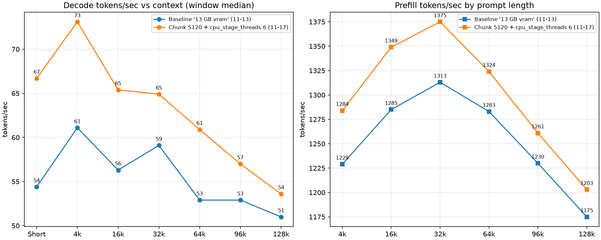

# KAT-Coder V2.5 Dev — EXL3 5.0 bpw (HQ)

KAT-Coder V2.5 Dev MTP, EXL3 5.00 bpw "hq" kernel, served with TabbyApi /
exllamav3 on the same RDNA4 platform as the [Qwen3.6-35B](QWEN3.6-35B-A3B.md)
and [Ornith](ORNITH1.5-35B-A3B.md) benchmarks. Full-range runs
(4k→128k, MTP 2 draft tokens, no external drafter):

| Run | Timestamp | Tag (adjusted terminology) |
|-----|-----------|--------------------------------------|
| Baseline | 2026-11-13 15:09Z | serve defaults ("13 GB vram" tag) |
| **Tweaked (latest full run)** | 2026-11-17 11:30Z | chunk 5120, output_chunking, vision offload, cpu_stage_threads 6, threads 7, MTP (2), **cpu_moe_split_experts 190** |

## CPU MOE split experts = 190 is the floor

`cpu_moe_split_experts: 190` is the lowest value that starts. Anything lower
OOMs before the server comes up, so a lower offload (fewer experts in system
RAM, which should in theory be faster) **cannot be verified** — the server will
not start with it.

Resource usage on the tweaked run:

- **VRAM max ~12.9 GB**
- **System RAM ~20.7 GB**

## Tweaked run — 2026-11-17 11:30Z (full range, MTP 2)

### Prefill

| Context | TPS | TTFT (s) | Runs |
|---------|-----|----------|------|
| 4k | 1 284.3 | 3.22 | 5 |
| 16k | 1 349.2 | 12.08 | 5 |
| 32k | 1 374.8 | 23.78 | 5 |
| 64k | 1 324.1 | 49.38 | 5 |
| 96k | 1 261.5 | 78.17 | 2 |
| 128k* | 1 202.6 | 107.31 | 2 |

*The benchmark target reads 126k; actual prompt was 128 987 tokens — the usual
128k-full-budget run (same convention as the Qwen3.6 tables).*

### Decode (window medians, 512-token sequences)

| Context | Min | Median | Max | Runs |
|---------|-----|--------|-----|------|
| Short | 64.81 | 66.73 | 71.23 | 5 |
| 4k | 70.00 | 73.10 | 74.20 | 5 |
| 16k | 60.83 | 65.39 | 71.06 | 5 |
| 32k | 57.24 | 64.91 | 73.21 | 5 |
| 64k | 54.21 | 60.92 | 64.59 | 5 |
| 96k (n=2) | 54.75 | 56.98 | 59.22 | 2 |
| 128k (n=2) | 52.57 | 53.57 | 54.58 | 2 |

No early stops in any run. 96k/128k medians rest on 2 runs each.

## vs the 2026-11-13 baseline run

| Context | Baseline | Tweaked | Δ |
|---------|----------|---------|---|
| Decode short | 54.42 | 66.73 | **+22.6%** |
| Decode @4k | 61.11 | 73.10 | +19.6% |
| Decode @16k | 56.31 | 65.39 | +16.1% |
| Decode @32k | 59.14 | 64.91 | +9.8% |
| Decode @64k | 52.89 | 60.92 | +15.2% |
| Decode @96k (n=2) | 52.86 | 56.98 | +7.8% |
| Decode @128k (n=2) | 51.01 | 53.57 | +5.0% |
| Prefill 4k | 1 229.0 | 1 284.3 | +4.5% |
| Prefill 32k | 1 313.1 | 1 374.8 | +4.7% |
| Prefill 128k | 1 175.0 | 1 202.6 | +2.3% |

The tweak bundle (chunk 5120 + cpu_stage_threads 6 + threads 7 +
output_chunking + vision offload) buys a solid decode lift across the whole
range — largest at short context (+22.6%), shrinking toward 128k (+5.0%);
prefill is roughly flat (+2–5%). (The baseline's tag only says "13 GB vram",
so this is a whole-config comparison rather than an isolated A/B.)

## Graph

Generated by [plots/kat_coder.py](plots/kat_coder.py).

## Raw results

- [results/kat-coder/20261117T113004Z-kat-coder-v2-5-dev-mtp-exl3-5bpw-hq.json](results/kat-coder/20261117T113004Z-kat-coder-v2-5-dev-mtp-exl3-5bpw-hq.json) — tweaked full run (this page)
- [results/kat-coder/20261113T150956Z-kat-coder-v2-5-dev-mtp-exl3-5bpw-hq.json](results/kat-coder/20261113T150956Z-kat-coder-v2-5-dev-mtp-exl3-5bpw-hq.json) — "13 GB vram" baseline full run