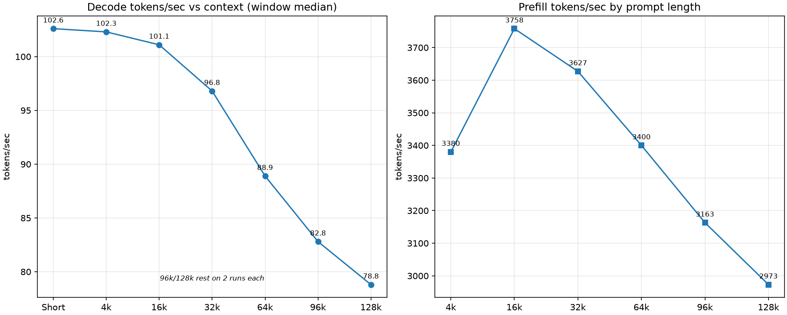

# Nemotron 3.5 Lightning 30B-A3B — EXL3 3.25 bpw

Nemotron 3.5 Lightning 30B-A3B (`Nemotron-3.5-Lightning-EXL3-3.25`), EXL3
3.25 bpw, served with TabbyApi / exllamav3 on the same RDNA4 platform as the
[Qwen3.6-35B](QWEN3.6-35B-A3B.md), [Ornith](ORNITH1.5-35B-A3B.md) and
[KAT-Coder](KAT-Coder.md) benchmarks. No drafter/speculation specified in the
run tag.

| Run | Timestamp | Tag (adjusted terminology) |
|-----|-----------|--------------------------------------|
| ~~Excluded~~ (no JSON copied) | 2026-11-17 14:19Z | expert offload 5, chunk 4096, Q8 cache — stopped short of 128k |
| **Full run** | 2026-11-17 15:12Z | expert offload 5, chunk 4096, Q8 cache, max_context 153 600, ~15 GB VRAM idle |

The 14:19Z run used the model's stock context and never reached the 128k
bucket; the 15:12Z run raised `max_context` to 153 600 and completed the full
4k→128k sweep. Per the repo convention, only the latter is copied to
`results/nemotron/`.

## Run — 2026-11-17 15:12Z (full range 4k→128k)

### Prefill

| Context | TPS | TTFT (s) | Runs |
|---------|-----|----------|------|
| 4k | 3 380.2 | 1.24 | 5 |
| 16k | 3 758.0 | 4.40 | 5 |
| 32k | 3 626.8 | 9.13 | 5 |
| 64k | 3 399.8 | 19.51 | 5 |
| 96k (n=2) | 3 163.1 | 31.70 | 2 |
| 128k* (n=2) | 2 973.0 | 44.12 | 2 |

*The benchmark target reads 126k; actual prompt was 131 128 tokens — the usual
128k-full pool run (same convention as the other model pages).*

### Decode (window medians, 512-token sequences)

| Context | Min | Median | Max | Runs |
|---------|-----|--------|-----|------|
| Short | 102.36 | 102.59 | 102.80 | 5 |
| 4k | 101.97 | 102.26 | 102.36 | 5 |
| 16k | 100.96 | 101.05 | 101.89 | 5 |
| 32k | 94.75 | 96.81 | 98.29 | 5 |
| 64k | 86.73 | 88.88 | 90.29 | 5 |
| 96k (n=2) | 82.43 | 82.76 | 83.09 | 2 |
| 128k (n=2) | 78.55 | 78.81 | 79.08 | 2 |

No early stops. 96k/128k medians rest on 2 runs each.

## Graph

Generated by [plots/nemotron_lightning.py](plots/nemotron_lightning.py).

## Raw results

- [results/nemotron/20261117T151238Z-nemotron-3-5-lightning-exl3-3-25.json](results/nemotron/20261117T151238Z-nemotron-3-5-lightning-exl3-3-25.json) — the full-range run above