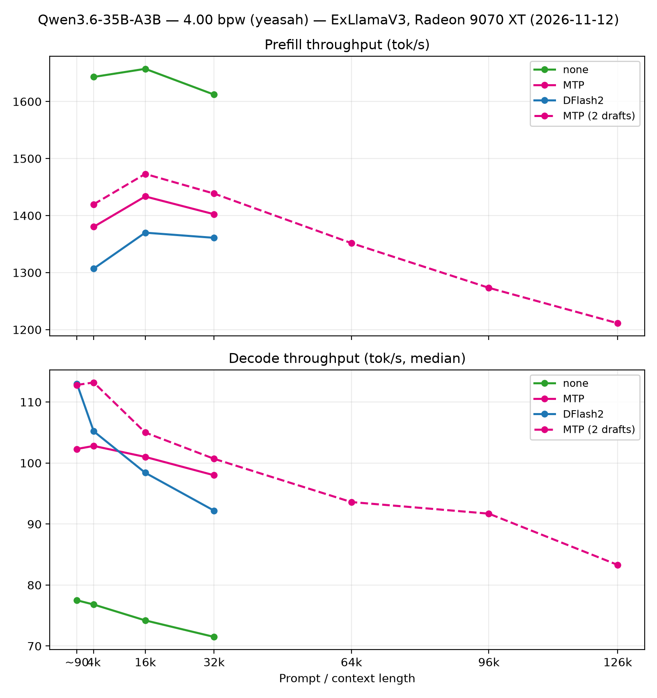
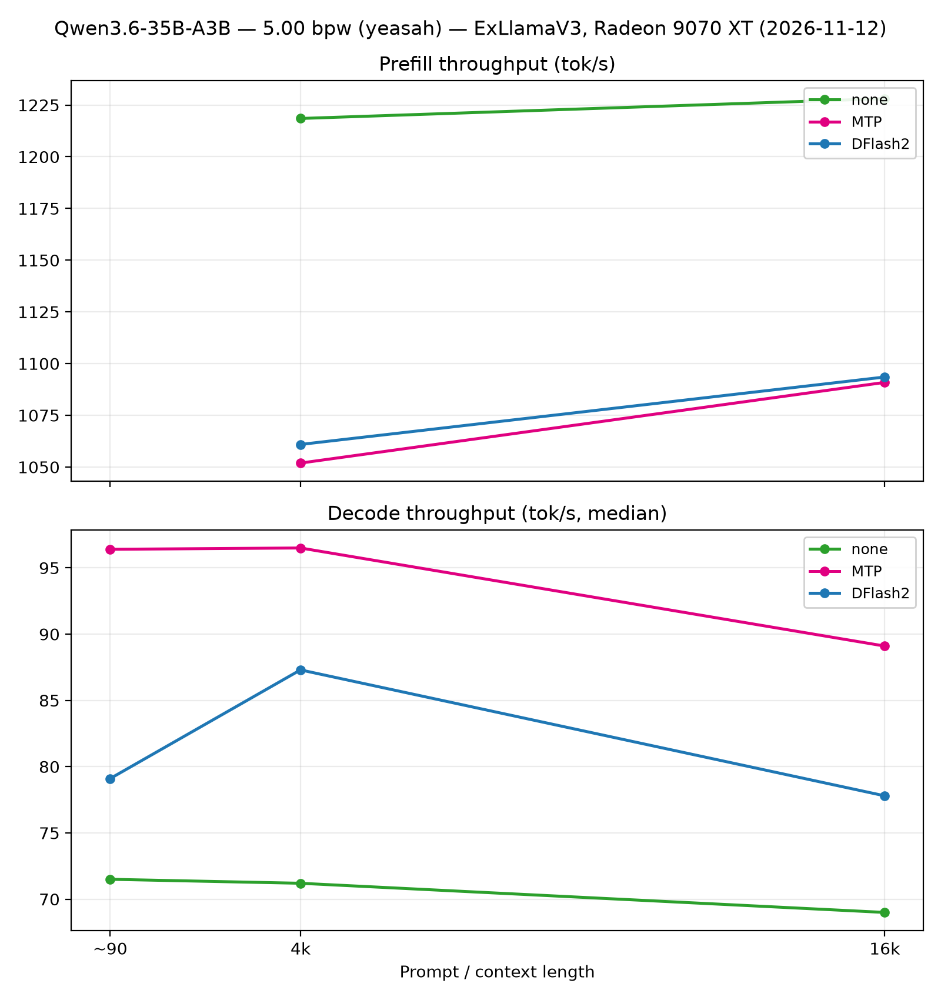
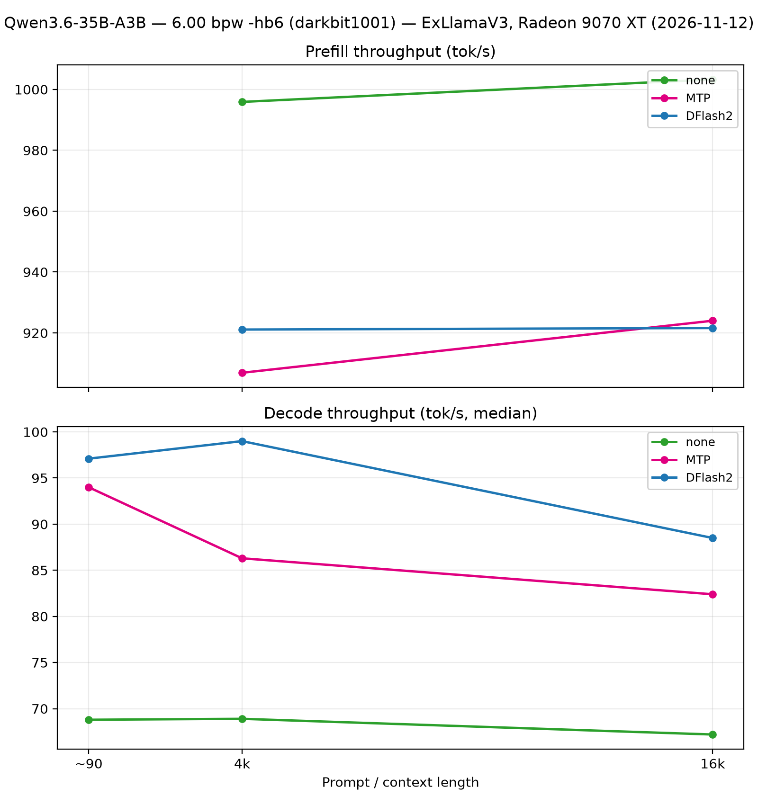

# Qwen3.6-35B-A3B — EXL3 quants on ExLlamaV3 (Radeon 9070 XT)

Ten runs, all dated 2026-11-12: three EXL3 quantizations (4.00, 5.00 and 6.00
bpw -hb6), each benchmarked three ways — no speculation, MTP (drafts from the
model's own MTP layers), and a separate DFlash2 draft — plus one aside:
a full-range 4.00 bpw MTP run with 2 draft tokens. Prefill/decode lengths:
4k and 16k for all runs; 32k for the 4.00 bpw set (the aside run extends to
126k).

## Sources

| Quant | Hugging Face | Local name |
| --- | --- | --- |
| 4.00 bpw | [yeasah/Qwen3.6-35B-A3B-exl3](https://huggingface.co/yeasah/Qwen3.6-35B-A3B-exl3) | `q4-exl3-4.00bpw` |
| 5.00 bpw | [yeasah/Qwen3.6-35B-A3B-exl3](https://huggingface.co/yeasah/Qwen3.6-35B-A3B-exl3) (same repo) | `q5-exl3-5.00bpw` |
| 6.00 bpw -hb6 | [darkbit1001/Qwen3.6-35B-A3B-EXL3-6.00bpw-hb6](https://huggingface.co/darkbit1001/Qwen3.6-35B-A3B-EXL3-6.00bpw-hb6) | `q6-exl3-6.00bpw-hb6` |

DFlash2 draft quant: `q-dflash2-35b-exl3-3.00bpw` (local).

## Setup

- **Model:** Qwen3.6-35B-A3B (~35B MoE, A3B active).
- **Engine:** ExLlamaV3 (same fork/build as the Ornith 20:53Z run — see
  [README.md](README.md)).
- **Bench tool / protocol:** same llm-bench protocol as the README (prefill at
  fixed lengths, decode 512 tokens, 5 runs, medians). 32k–128k still
  outstanding for the 5.00/6.00 bpw quants.

### Per-run configs

Common to all runs: `backend: exllamav3`, `gpu_split_auto` (no GPU split),
`autosplit_reserve: 768` MB, KV cache Q8 @ 131 072 tokens, `max_seq_len: 130 816`,
`max_batch_size: 1`. Sampling overrides: T 0.6, top-p 0.95, top-k 20, min-p 0,
penalties 0.

| Time (UTC) | Quant | Spec mode | `cpu_moe_split_experts` | VRAM |
| --- | --- | --- | ---: | --- |
| 11:20:00 | 4.00 bpw | MTP (2 draft tokens) — aside | 95 | ~15.4 GB |
| 11:02:24 | 4.00 bpw | none | 90 | ~15.4 GB |
| 10:56:11 | 4.00 bpw | MTP (5 draft tokens) | 100 | ~15.4 GB |
| 10:50:07 | 4.00 bpw | DFlash2 (5 draft tokens) | 100 | ~15.4 GB |
| 10:27:06 | 5.00 bpw | none | 125 | ~15.4 GB |
| 10:21:46 | 5.00 bpw | MTP (4 draft tokens) | 135 | ~15.1 GB |
| 10:17:15 | 5.00 bpw | DFlash2 (5 draft tokens) | 135 | ~15.3 GB |
| 09:10:45 | 6.00 bpw | none | 145 | ~15.4 GB |
| 09:15:48 | 6.00 bpw | MTP (4 draft tokens) | 150 | ~15.4 GB |
| 09:39:39 | 6.00 bpw | DFlash2 (5 draft tokens) | 155 | ~15.2 GB |

### Draft configs (as run)

MTP (draft comes from the main quant's MTP layers; no separate draft model —
`draft_num_tokens` varied per run: 2, 4 or 5 — see the table):

```yaml
draft_model:
  draft_mode: mtp
  draft_cache_mode: Q4
  draft_num_tokens: 4
  dynamic_draft: true
  draft_confidence: 0.4
```

DFlash2 (separate 3.0 bpw draft, 5 draft tokens in all its runs):

```yaml
draft_model:
  draft_mode: model
  draft_model_dir: ../models
  draft_model_name: q-dflash-2-35b-exl3-3.00bpw
  draft_cache_mode: Q4
  draft_num_tokens: 5
  dynamic_draft: true
  draft_confidence: 0.4
```

## Results

### Prefill, tok/s (TTFT s)

| Quant | none | MTP | DFlash2 |
| --- | ---: | ---: | ---: |
| **4.00 bpw** 4k | **1 643.1** (2.52) | 1 380.3 (3.00) | 1 307.0 (3.17) |
| **4.00 bpw** 16k | **1 657.3** (9.83) | **1 433.5** (11.37) | 1 370.0 (11.89) |
| **4.00 bpw** 32k | **1 612.2** (20.28) | **1 402.4** (23.32) | 1 361.0 (24.03) |
| **5.00 bpw** 4k | **1 218.5** (3.40) | 1 051.9 (3.94) | 1 060.9 (3.90) |
| **5.00 bpw** 16k | **1 228.1** (13.27) | 1 090.9 (14.93) | **1 093.5** (14.90) |
| **5.00 bpw** 32k | — | — | — |
| **6.00 bpw** 4k | **995.9** (4.16) | 906.9 (4.57) | 921.1 (4.50) |
| **6.00 bpw** 16k | **1 003.3** (16.24) | 924.0 (17.63) | **921.6** (17.68) |
| **6.00 bpw** 32k | — | — | — |

(— = not run.)

### Decode, tok/s (median / min–max, 5 runs each)

| Quant | none | MTP | DFlash2 |
| --- | ---: | ---: | ---: |
| **4.00 bpw** short (~90) | 77.5 (77.2–78.1) | 102.3 (99.8–113.0) | **113.0** (106.8–115.8) |
| **4.00 bpw** 4 000 | 76.8 (76.5–77.4) | 102.8 (98.9–106.7) | **105.2** (103.6–112.2) |
| **4.00 bpw** 16 000 | 74.2 (73.6–74.7) | **101.0** (95.3–106.2) | 98.4 (95.9–102.7) |
| **4.00 bpw** 32 000 | 71.5 (69.6–72.0) | **98.0** (92.8–99.7) | 92.2 (84.5–101.3) |
| **5.00 bpw** short | 71.5 (70.9–73.1) | **96.4** (93.1–103.5) | 79.1 (68.4–86.5) |
| **5.00 bpw** 4 000 | 71.2 (71.1–73.0) | **96.5** (83.0–96.8) | 87.3 (83.4–89.2) |
| **5.00 bpw** 16 000 | 69.0 (68.4–69.6) | **89.1** (87.5–92.6) | 77.8 (74.2–87.4) |
| **5.00 bpw** 32 000 | — | — | — |
| **6.00 bpw** short | 68.8 (67.1–71.0) | 94.0 (87.6–97.0) | **97.1** (94.6–99.4) |
| **6.00 bpw** 4 000 | 68.9 (68.5–70.0) | 86.3 (78.0–91.1) | **99.0** (93.5–107.1) |
| **6.00 bpw** 16 000 | 67.2 (65.9–67.6) | 82.4 (75.7–84.2) | **88.5** (85.1–98.0) |
| **6.00 bpw** 32 000 | — | — | — |

## Aside — 4.00 bpw, MTP with 2 draft tokens (11:20Z, full range)

Follow-up 4.00 bpw MTP run with `draft_num_tokens: 2` (was 5) and
`cpu_moe_split_experts: 95`, extending prefill and decode out to 126k:

| Prompt length | Prefill tok/s (TTFT s) | Decode tok/s (median, min–max) |
| ---: | --- | --- |
| ~90 (short) | — | 112.8 (110.5–116.4) |
| 4 000 | 1 419.8 (2.92) | 113.2 (107.2–115.6) |
| 16 000 | 1 473.0 (11.06) | 105.0 (101.1–110.9) |
| 32 000 | 1 438.6 (22.73) | 100.7 (98.3–101.4) |
| 64 000 | 1 351.7 (48.37) | 93.6 (89.8–96.1) |
| 96 000 | 1 273.3 (77.37) | 91.7 (90.9–92.5) † |
| 126 000 | 1 211.2 (106.5) | 83.3 (83.2–83.5) † |

(† median over 2 runs; no early-stop runs seen.)

- Dropping draft tokens 5 → 2 raised both prefill and decode vs the earlier
  4.00 bpw MTP run: prefill 1 420/1 473/1 439 vs 1 380/1 434/1 402 at
  4k/16k/32k; decode 112.8 short (vs 102.3, +10%) and 100.7 at 32k (vs 98.0).
- At 32k it now beats the DFlash2 draft (100.7 vs 92.2).
- Long-context slope: 112.8 → 93.6 (64k, ~17%) → 83.3 (126k, ~26%) — the
  flattest decode slope of any line reaching this range.

## Throughput graphs

One figure per quant (prefill on top, decode below — short-context decode
plotted at the left edge). In the 4.00 bpw figure, the **dashed magenta line
is the 11:20Z MTP aside run** (2 draft tokens, full range to 126k).

**4.00 bpw**



**5.00 bpw**



**6.00 bpw**



Generated with [`plots/qwen_per_quant.py`](plots/qwen_per_quant.py)
(`uv run --with matplotlib python qwen_per_quant.py`).

## Findings

1. **Speculation is a big decode win on this model/engine** — unlike the
   Ornith llama.cpp result where MTP slowed decode down. No-spec decode is
   ~67–78 tok/s; with a draft it climbs to ~78–113 across quants.
2. **4.00 bpw + DFlash2 is the decode champion** — 113.0 short, 105.2 at 4k,
   98.4 at 16k, 92.2 at 32k. It also produces the widest spreads of any draft
   run (e.g. 32k: 84.5–101.3), so treat its lead as ~10–16% rather than the raw
   gap at every point.
3. **The best draft mode keeps flipping with quant — and with context.** At
   4.00 bpw, DFlash2 leads short/4k (113.0/105.2) but MTP takes over at 16k and
   32k (101.0/98.0 vs 98.4/92.2). At 5.00 bpw MTP leads everywhere (DFlash2 is
   weak there: 79.1/87.3/77.8). At 6.00 bpw DFlash2 leads everywhere.
4. **MTP decode is nearly context-flat at 4.00 bpw** — 102.3 short → 98.0 at
   32k (~4% drop); DFlash2 falls ~18% (113.0 → 92.2), no-spec ~8% (77.5 → 71.5).
5. **Spec costs prefill bandwidth, with the hit growing as the quant drops**:
   ~16% at 4.00 (1 643→1 380 at 4k), ~14% at 5.00 (1 218→1 052), ~9% at
   6.00 (996→907).
6. **Prefill scales strongly with quant size** — no-spec 4k prefill: 1 643
   (4.00) / 1 218 (5.00) / 996 tok/s (6.00), a ~65% spread for 2 bpw.
7. **No-spec decode scales with quant size too**, more gently: 77.5 (4.00) /
   71.5 (5.00) / 68.8 (6.00) short-context.
8. **VRAM is flat across the board** — ~15.1–15.4 GB for all nine runs
   regardless of quant or spec mode.
9. **Runs can be noisy; medians matter** — e.g. q5 DFlash2 short-context
   spread 68.4–86.5, q4 DFlash2 32k spread 84.5–101.3.

## Caveats

- Only the 4.00 bpw aside run reached beyond 32k; 32k+ is still outstanding
  for the other 4.00 bpw runs and for 5.00/6.00 bpw.
- The 96k/126k decode medians rest on 2 runs († in the aside table).
- `cpu_moe_split_experts` differs per run (90/100/100 for 4.00, 125/135/135 for
  5.00, 145/150/155 for 6.00): draft variants load extra weights, so absolute
  numbers across modes conflate offload level with speculation. MTP
  `draft_num_tokens` also varied per run (2, 4, 5); DFlash2 runs all used 5.
- `prompt_tokens unchecked` flag applies to all runs
  ("non-Qwen model" at 4k/16k, "no reference count" at 32k).
- Medians over 5 runs each; no early-stop runs were seen.

## Raw results

- `exllamav3-20261112T112000Z-q4-exl3-4-00bpw.json` (4.00 bpw, MTP 2 draft tokens — aside, full range)
- `exllamav3-20261112T110224Z-q4-exl3-4-00bpw.json` (4.00 bpw, no spec)
- `exllamav3-20261112T105611Z-q4-exl3-4-00bpw.json` (4.00 bpw, MTP)
- `exllamav3-20261112T105007Z-q4-exl3-4-00bpw.json` (4.00 bpw, DFlash2)
- `exllamav3-20261112T102706Z-q5-exl3-5-00bpw.json` (5.00 bpw, no spec)
- `exllamav3-20261112T102146Z-q5-exl3-5-00bpw.json` (5.00 bpw, MTP)
- `exllamav3-20261112T101715Z-q5-exl3-5-00bpw.json` (5.00 bpw, DFlash2)
- `exllamav3-20261112T091045Z-q6-exl3-6-00bpw-hb6.json` (6.00 bpw, no spec)
- `exllamav3-20261112T091548Z-q6-exl3-6-00bpw-hb6.json` (6.00 bpw, MTP)
- `exllamav3-20261112T093939Z-q6-exl3-6-00bpw-hb6.json` (6.00 bpw, DFlash2)

(Also in `../llm-bench/results/` under their original `20261112T…` names.)