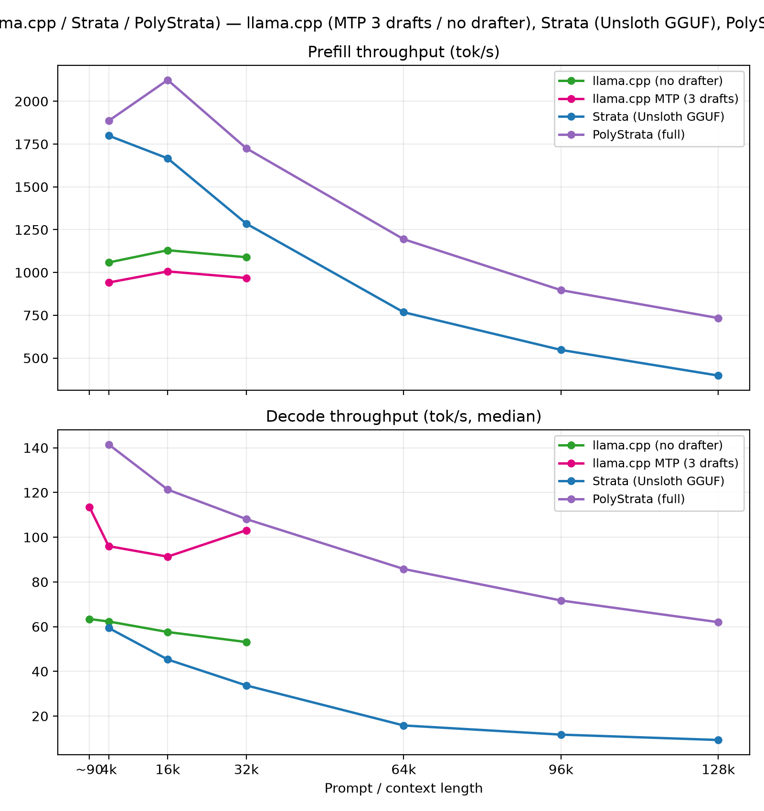

# Qwen3.6-35B-A3B — EXL3 quants on ExLlamaV3 (Radeon 9070 XT)

Thirteen runs, all dated 2026-11-12: three EXL3 quantizations (4.00, 5.00 and
6.00 bpw -hb6), each benchmarked three ways — no speculation, MTP (drafts from
the model's own MTP layers), and a separate DFlash2 draft — plus four asides:
full-range MTP and DFlash2 runs at both 4.00 and 5.00 bpw, all with
2 draft tokens.
Prefill/decode lengths: 4k and 16k for all runs; 32k for the 4.00 bpw set
(the aside runs extend to 128k).

In the same day, a separate GGUF pass ran with three engines/modes:
llama.cpp with and without MTP, the original Strata engine (Unsloth UD
Q4_K_XL GGUF), and PolyStrata (full suite) — see the GGUF section below.

## Sources

| Quant | Hugging Face | Local name |
| --- | --- | --- |
| 4.00 bpw | [yeasah/Qwen3.6-35B-A3B-exl3](https://huggingface.co/yeasah/Qwen3.6-35B-A3B-exl3) | `q4-exl3-4.00bpw` |
| 5.00 bpw | [yeasah/Qwen3.6-35B-A3B-exl3](https://huggingface.co/yeasah/Qwen3.6-35B-A3B-exl3) (same repo) | `q5-exl3-5.00bpw` |
| 6.00 bpw -hb6 | [darkbit1001/Qwen3.6-35B-A3B-EXL3-6.00bpw-hb6](https://huggingface.co/darkbit1001/Qwen3.6-35B-A3B-EXL3-6.00bpw-hb6) | `q6-exl3-6.00bpw-hb6` |

DFlash2 draft quant: `q-dflash2-35b-exl3-3.00bpw` (local).

## Setup

- **Model:** Qwen3.6-35B-A3B (~35B MoE, A3B active).
- **Engine:** ExLlamaV3 (same fork/build as the Ornith 20:53Z run — see
  [ORNITH1.5-35B-A3B.md](ORNITH1.5-35B-A3B.md)).
- **Bench tool / protocol:** same llm-bench protocol as the README (prefill at
  fixed lengths, decode 512 tokens, 5 runs, medians). 32k–128k still
  outstanding for the 5.00/6.00 bpw quants.

### Per-run configs

Common to all runs: `backend: exllamav3`, `gpu_split_auto` (no GPU split),
`autosplit_reserve: 768` MB, KV cache Q8 @ 131 072 tokens, `max_seq_len: 130 816`,
`max_batch_size: 1`. Sampling overrides: T 0.6, top-p 0.95, top-k 20, min-p 0,
penalties 0.

| Time (UTC) | Quant | Spec mode | `cpu_moe_split_experts` | VRAM |
| --- | --- | --- | ---: | --- |
| 12:49:35 | 5.00 bpw | MTP (2 draft tokens) — aside | 130 | ~15.6 GB |
| 12:19:21 | 5.00 bpw | DFlash2 (2 draft tokens) — aside | 135 | ~15.3 GB |
| 11:44:37 | 4.00 bpw | DFlash2 (2 draft tokens) — aside | 100 | ~15.6 GB |
| 11:20:00 | 4.00 bpw | MTP (2 draft tokens) — aside | 95 | ~15.7 GB |
| 11:02:24 | 4.00 bpw | none | 90 | ~15.4 GB |
| 10:56:11 | 4.00 bpw | MTP (5 draft tokens) | 100 | ~15.4 GB |
| 10:50:07 | 4.00 bpw | DFlash2 (5 draft tokens) | 100 | ~15.4 GB |
| 10:27:06 | 5.00 bpw | none | 125 | ~15.4 GB |
| 10:21:46 | 5.00 bpw | MTP (4 draft tokens) | 135 | ~15.1 GB |
| 10:17:15 | 5.00 bpw | DFlash2 (5 draft tokens) | 135 | ~15.3 GB |
| 09:10:45 | 6.00 bpw | none | 145 | ~15.4 GB |
| 09:15:48 | 6.00 bpw | MTP (4 draft tokens) | 150 | ~15.4 GB |
| 09:39:39 | 6.00 bpw | DFlash2 (5 draft tokens) | 155 | ~15.2 GB |

(The 4.00 bpw MTP aside used `cpu_moe_split_experts: 95` — the model did not
load at 100; the other asides ran at 100 (4.00 DFlash2), 130 (5.00 MTP) and
135 (5.00 DFlash2).)

### Draft configs (as run)

MTP (draft comes from the main quant's MTP layers; no separate draft model —
`draft_num_tokens` varied per run: 2, 4 or 5 — see the table):

```yaml
draft_model:
  draft_mode: mtp
  draft_cache_mode: Q4
  draft_num_tokens: 4
  dynamic_draft: true
  draft_confidence: 0.4
```

DFlash2 (separate 3.0 bpw draft; 5 draft tokens in the short-range runs, 2 in
the aside run):

```yaml
draft_model:
  draft_mode: model
  draft_model_dir: ../models
  draft_model_name: q-dflash-2-35b-exl3-3.00bpw
  draft_cache_mode: Q4
  draft_num_tokens: 5
  dynamic_draft: true
  draft_confidence: 0.4
```

## Results

### Prefill, tok/s (TTFT s)

| Quant | none | MTP | DFlash2 |
| --- | ---: | ---: | ---: |
| **4.00 bpw** 4k | **1 643.1** (2.52) | 1 380.3 (3.00) | 1 307.0 (3.17) |
| **4.00 bpw** 16k | **1 657.3** (9.83) | **1 433.5** (11.37) | 1 370.0 (11.89) |
| **4.00 bpw** 32k | **1 612.2** (20.28) | **1 402.4** (23.32) | 1 361.0 (24.03) |
| **5.00 bpw** 4k | **1 218.5** (3.40) | 1 051.9 (3.94) | 1 060.9 (3.90) |
| **5.00 bpw** 16k | **1 228.1** (13.27) | 1 090.9 (14.93) | **1 093.5** (14.90) |
| **5.00 bpw** 32k | — | 1 101.0 (29.70) | 1 129.9 (28.94) |
| **6.00 bpw** 4k | **995.9** (4.16) | 906.9 (4.57) | 921.1 (4.50) |
| **6.00 bpw** 16k | **1 003.3** (16.24) | 924.0 (17.63) | **921.6** (17.68) |
| **6.00 bpw** 32k | — | — | — |

(— = not run.)

### Decode, tok/s (median / min–max, 5 runs each)

| Quant | none | MTP | DFlash2 |
| --- | ---: | ---: | ---: |
| **4.00 bpw** short (~90) | 77.5 (77.2–78.1) | 102.3 (99.8–113.0) | **113.0** (106.8–115.8) |
| **4.00 bpw** 4 000 | 76.8 (76.5–77.4) | 102.8 (98.9–106.7) | **105.2** (103.6–112.2) |
| **4.00 bpw** 16 000 | 74.2 (73.6–74.7) | **101.0** (95.3–106.2) | 98.4 (95.9–102.7) |
| **4.00 bpw** 32 000 | 71.5 (69.6–72.0) | **98.0** (92.8–99.7) | 92.2 (84.5–101.3) |
| **5.00 bpw** short | 71.5 (70.9–73.1) | **96.4** (93.1–103.5) | 79.1 (68.4–86.5) |
| **5.00 bpw** 4 000 | 71.2 (71.1–73.0) | **96.5** (83.0–96.8) | 87.3 (83.4–89.2) |
| **5.00 bpw** 16 000 | 69.0 (68.4–69.6) | **89.1** (87.5–92.6) | 77.8 (74.2–87.4) |
| **5.00 bpw** 32 000 | — | 85.6 (83.5–87.2) | **86.6** (83.9–89.0) |
| **6.00 bpw** short | 68.8 (67.1–71.0) | 94.0 (87.6–97.0) | **97.1** (94.6–99.4) |
| **6.00 bpw** 4 000 | 68.9 (68.5–70.0) | 86.3 (78.0–91.1) | **99.0** (93.5–107.1) |
| **6.00 bpw** 16 000 | 67.2 (65.9–67.6) | 82.4 (75.7–84.2) | **88.5** (85.1–98.0) |
| **6.00 bpw** 32 000 | — | — | — |

## Asides — full range 4k → 128k (2 draft tokens)

Follow-up full-range runs with `draft_num_tokens: 2`:

| Run | Mode | Quant | `cpu_moe_split_experts` | VRAM |
| --- | --- | --- | ---: | ---: |
| 11:20:00Z | MTP | 4.00 bpw | 95 | ~15.7 GB |
| 11:44:37Z | DFlash2 | 4.00 bpw | 100 | ~15.6 GB |
| 12:49:35Z | MTP | 5.00 bpw | 130 | ~15.6 GB |
| 12:19:21Z | DFlash2 | 5.00 bpw | 135 | ~15.3 GB |

At both 4.00 and 5.00 bpw the two draft modes are a head-to-head at equal
draft count.

### 4.00 bpw — DFlash2 (11:44Z)

| Prompt length | Prefill tok/s (TTFT s) | Decode tok/s (median, min–max) |
| ---: | --- | --- |
| ~90 (short) | — | 105.4 (100.7–106.0) |
| 4 000 | 1 463.0 (2.83) | 107.0 (106.1–108.1) |
| 16 000 | 1 534.3 (10.62) | 98.9 (97.3–102.0) |
| 32 000 | 1 492.1 (21.91) | 93.0 (91.7–100.5) |
| 64 000 | 1 398.3 (46.76) | 86.3 (79.1–88.1) |
| 96 000 | 1 312.4 (75.07) | 80.1 (78.2–81.9) † |
| 128 000 | 1 245.6 (103.56) | 71.6 (68.6–74.6) † |

### 4.00 bpw — MTP (11:20Z)

| Prompt length | Prefill tok/s (TTFT s) | Decode tok/s (median, min–max) |
| ---: | --- | --- |
| ~90 (short) | — | 112.8 (110.5–116.4) |
| 4 000 | 1 419.8 (2.92) | 113.2 (107.2–115.6) |
| 16 000 | 1 473.0 (11.06) | 105.0 (101.1–110.9) |
| 32 000 | 1 438.6 (22.73) | 100.7 (98.3–101.4) |
| 64 000 | 1 351.7 (48.37) | 93.6 (89.8–96.1) |
| 96 000 | 1 273.3 (77.37) | 91.7 (90.9–92.5) † |
| 128 000 | 1 211.2 (106.5) | 83.3 (83.2–83.5) † |

(† median over 2 runs; no early-stop runs seen in either 4.00 bpw aside
run.)

4.00 bpw — MTP vs DFlash2 (both 2 draft tokens):

- **Decode: MTP leads the whole range** — 112.8 vs 105.4 short, 100.7 vs 93.0
  at 32k, 83.3 vs 71.6 at 128k. The DFlash2 slope is steeper (−32% from
  short to 128k; MTP −26%).
- **Prefill: DFlash2 is ~3% faster everywhere** — 1 463/1 534/1 492 vs
  1 420/1 473/1 439 at 4k/16k/32k; 1 246 vs 1 211 at 128k.
- vs the 5-draft runs: dropping to 2 draft tokens lifted DFlash2 prefill
  (1 463/1 534 vs 1 307/1 370 at 4k/16k) but cut its short-context decode
  (105.4 vs 113.0); MTP gained on both (prefill 1 420/1 473 vs 1 380/1 434;
  decode 112.8 vs 102.3).

### 5.00 bpw — MTP (12:49Z)

| Prompt length | Prefill tok/s (TTFT s) | Decode tok/s (median, min–max) |
| ---: | --- | --- |
| ~90 (short) | — | 96.1 (90.1–98.6) |
| 4 000 | 1 089.1 (3.80) | 97.2 (87.3–100.2) |
| 16 000 | 1 120.0 (14.55) | 94.9 (88.5–95.6) |
| 32 000 | 1 101.0 (29.70) | 85.6 (83.5–87.2) |
| 64 000 | 1 047.9 (62.39) | 81.6 (77.4–85.9) |
| 96 000 | 998.5 (98.66) | 80.0 (79.1–80.9) † |
| 128 000 | 958.2 (134.61) | 75.7 (74.4–77.0) † |

(† median over 2 runs.)

### 5.00 bpw — DFlash2 (12:19Z)

| Prompt length | Prefill tok/s (TTFT s) | Decode tok/s (median, min–max) |
| ---: | --- | --- |
| ~90 (short) | — | 98.7 (96.7–99.0) |
| 4 000 | 1 128.0 (3.67) | 99.2 (93.8–100.6) |
| 16 000 | 1 155.0 (14.11) | 94.0 (92.1–94.7) |
| 32 000 | 1 129.9 (28.94) | 86.6 (83.9–89.0) |
| 64 000 | 1 074.1 (60.87) | 80.5 (77.6–81.3) |
| 96 000 | 1 011.3 (97.41) | 76.1 (75.7–76.5) † |
| 128 000 | 978.2 (131.87) | 67.2 (63.3–71.1) † |

(† median over 2 runs.)

5.00 bpw — MTP vs DFlash2 (both 2 draft tokens):

- Same story as 4.00: **DFlash2 faster in prefill** (1 128/1 155/1 130 vs
  1 089/1 120/1 101 at 4k/16k/32k, ~3–4%), **neck-and-neck decode short of
  64k** (98.7/99.2/94.0/86.6 vs 96.1/97.2/94.9/85.6), then **MTP pulls ahead**
  at 96k/128k (76.1 vs 80.0, 67.2 vs 75.7). MTP's slope is flattest: −21% from
  short to 128k vs −32% for DFlash2.
- vs the earlier 4-draft MTP run: 2 draft tokens gained prefill
  (1 089/1 120 vs 1 052/1 091) and held decode roughly flat (96.1 vs 96.4
  short) — so the earlier "DFlash2 flips 5.00 bpw" picture softens: re-run
  with equal draft tokens, MTP keeps the long-context win there too.

## GGUF runs — UD Q4_K_XL (llama.cpp, Strata, PolyStrata)

Three more runs on the same day: the UD Q4_K_XL GGUF benchmarked with
llama.cpp (MTP on/off), the original Strata engine (Unsloth build of the
same quant), and PolyStrata (full-suite run). Settings follow the Ornith
sweep in [ORNITH1.5-35B-A3B.md](ORNITH1.5-35B-A3B.md) unless tagged into the run:

| Time (UTC) | Engine | Drafter | Tag extras (beyond the shared settings) |
| --- | --- | --- | --- |
| 13:28:41 | llama.cpp | MTP, 3 draft tokens | `cpu_moe 28` |
| 13:41:57 | llama.cpp | none | `cpu_moe 25` |
| 15:14:00 | Strata (Unsloth GGUF) | none | start time 360 s; 15.3 GB VRAM, 21.8 GB system RAM |
| 15:52:39 | PolyStrata | none | full suite (4k→128k) |

### Prefill, tok/s (TTFT s)

| Run | 4 000 | 16 000 | 32 000 | 64 000 | 96 000 | 128 000 |
| --- | ---: | ---: | ---: | ---: | ---: | ---: |
| llama.cpp MTP | 941.1 (4.40) | 1 006.2 (16.19) | 967.8 (33.79) | — | — | — |
| llama.cpp no-drafter | 1 058.3 (3.91) | 1 129.9 (14.42) | **1 089.2** (30.02) | — | — | — |
| Strata (Unsloth GGUF) | 1 799.1 (2.30) | 1 666.6 (9.78) | 1 285.2 (25.44) | 767.8 (85.15) | 547.7 (179.87) | 397.9 (324.17) |
| PolyStrata (full) | **1 885.6** (2.20) | **2 124.3** (7.67) | **1 725.2** (18.95) | **1 194.3** (54.75) | **896.9** (109.84) | **733.7** (175.80) |

### Decode, tok/s (median / min–max, 5 runs each — no ~90 short in the
full-range runs)

| Run | ~90 (short) | 4 000 | 16 000 | 32 000 | 64 000 | 96 000 | 128 000 |
| --- | ---: | ---: | ---: | ---: | ---: | ---: | ---: |
| llama.cpp MTP | 113.5 (97.5–144.4) | 96.0 (90.4–100.3) | 91.3 (86.0–100.7) | 103.1 (91.9–123.7) | — | — | — |
| llama.cpp no-drafter | 63.4 (63.2–63.7) | 62.3 (62.1–62.9) | 57.6 (57.3–58.1) | 53.1 (52.9–53.3) | — | — | — |
| Strata (Unsloth GGUF) | — | 59.4 (55.6–63.6) | 45.3 (44.5–47.9) | 33.7 (33.1–34.6) | 15.8 (15.5–16.3) | 11.7 (11.6–11.7) † | 9.3 (9.2–9.3) † |
| PolyStrata (full) | — | **141.5** (138.6–146.6) | **121.3** (120.1–122.5) | **108.1** (106.2–109.6) | **85.8** (84.0–89.0) | **71.7** (71.6–71.8) † | **62.0** (60.9–63.0) † |

(† median over 2 runs.)

- **PolyStrata (full suite) is the decode and prefill standout** —
  141.5/121.3/108.1/85.8 at 4k/16k/32k/64k and still 62.0 at 128k (~4×
  Strata there), prefill strongest everywhere (1 885.6/2 124.3 at 4k/16k;
  733.7 at 128k). No drafter in the config.
- **Strata (Unsloth GGUF) collapses in long context** — prefill is decent
  short (1 799 at 4k, ~70% ahead of llama.cpp) but decode falls off a cliff:
  59.4 → 9.3 from 4k to 128k (−84%), and prefill is down to 397.9 by 128k
  (TTFT 324 s). Only 15.3 GB makes it to the GPU; the rest rides 21.8 GB of
  system RAM behind a ~360 s start, so it is CPU-bound past ~16k. It stays
  competitive (slightly ahead of llama.cpp MTP) below 32k.
- **llama.cpp MTP (3 draft tokens) roughly doubles llama.cpp decode** —
  63.4 → 113.5 short, 62.3 → 96.0 at 4k. Opposite of the Ornith llama.cpp
  result in [ORNITH1.5-35B-A3B.md](ORNITH1.5-35B-A3B.md), where MTP cost ~44% — different build
  and different GGUF, so take it as a soft point.
- The 32k MTP decode (103.1, spread 91.9–123.7) is above its 16k value
  (91.3); wide spread, handle with care.

## Throughput graphs

One figure per quant (prefill on top, decode below — short-context decode
plotted at the left edge). In the 4.00 and 5.00 bpw figures, the **dashed
lines with square markers are the aside runs** with 2 draft tokens (red =
MTP 11:20Z @4.00 and 12:49Z @5.00; orange = DFlash2 11:44Z @4.00 and
12:19Z @5.00), full range to 128k.

**4.00 bpw**


**5.00 bpw**


**6.00 bpw**


**GGUF (UD Q4_K_XL: llama.cpp ± MTP vs PolyStrata)**



Generated with [`plots/qwen_per_quant.py`](plots/qwen_per_quant.py)
(`uv run --with matplotlib python qwen_per_quant.py`).

## Findings

1. **Speculation is a big decode win on this model/engine** — unlike the
   Ornith llama.cpp result where MTP slowed decode down. No-spec decode is
   ~67–78 tok/s; with a draft it climbs to ~78–113 across quants.
2. **4.00 bpw + DFlash2 is the decode champion in the short-range set** —
   113.0 short, 105.2 at 4k, 98.4 at 16k, 92.2 at 32k. It also produces the
   widest spreads of any draft run (e.g. 32k: 84.5–101.3), so treat its lead
   as ~10–16% rather than the raw gap at every point. (In the full-range
   aside with 2 draft tokens, MTP leads DFlash2 at every context — see Aside.)
3. **Equal-draft-token head-to-heads are settled**: MTP wins decode over the
   full range at both 4.00 and 5.00 bpw (DFlash2 is closer at 5.00 short of
   64k), while DFlash2 wins prefill by ~3% at both. Against the original
   short-range runs (unequal draft tokens) DFlash2 led at 4.0 bpw short/4k
   and — until MTP was re-run at 2 draft tokens — at 5.00. At 6.00 bpw
   DFlash2 leads the short-range set everywhere.
4. **MTP decode is nearly context-flat at 4.00 bpw** — 102.3 short → 98.0 at
   32k (~4% drop); DFlash2 falls ~18% (113.0 → 92.2), no-spec ~8% (77.5 → 71.5).
5. **Spec costs prefill bandwidth, with the hit growing as the quant drops**:
   ~16% at 4.00 (1 643→1 380 at 4k), ~14% at 5.00 (1 218→1 052), ~9% at
   6.00 (996→907).
6. **Prefill scales strongly with quant size** — no-spec 4k prefill: 1 643
   (4.00) / 1 218 (5.00) / 996 tok/s (6.00), a ~65% spread for 2 bpw.
7. **No-spec decode scales with quant size too**, more gently: 77.5 (4.00) /
   71.5 (5.00) / 68.8 (6.00) short-context.
8. **VRAM is nearly flat** — ~15.1–15.4 GB for the short-range runs
   regardless of quant or spec mode; the 2-draft-token aside runs sit slightly
   higher (~15.3–15.7 GB).
9. **Runs can be noisy; medians matter** — e.g. q5 DFlash2 short-context
   spread 68.4–86.5, q4 DFlash2 32k spread 84.5–101.3.
10. **PolyStrata (full suite, UD Q4_K_XL GGUF) is the clear winner on this
    machine** — decode 141.5/121.3/108.1/85.8 at 4k/16k/32k/64k and 62.0 at
    128k; prefill 1 885.6/2 124.3 at 4k/16k (733.7 at 128k). Well ahead of
    the best ExLlamaV3 decode (~113) with no drafter in the config.
11. **Strata (Unsloth GGUF, original engine) is the opposite outlier** —
    prefill fine short (1 799 at 4k) but decode 59.4 → 9.3 from 4k → 128k
    (−84%); only 15.3 GB makes it to the GPU, the rest rides system RAM
    (21.8 GB). Usable to ~16k only.
12. **llama.cpp + MTP was in the plus on this build** — 3-draft MTP is
    +80% decode over the no-drafter run on the same engine (63.4 → 113.5);
    on the Ornith build the same feature cost ~44%.

## Caveats

- Runs beyond 32k exist only for the 4.00 and 5.00 bpw asides (both modes);
  still outstanding for 6.00 bpw and the remaining short-range runs.
- The 96k/128k decode medians rest on 2 runs († in each aside table).
- The GGUF runs: llama.cpp stops at 32k (64k+ no-drafter still
  outstanding); Strata and PolyStrata reach 128k but their 96k/128k decode
  medians rest on 2 runs (†). The full-range runs have no ~90
  short-context decode.
- `cpu_moe_split_experts` differs per run (90/100/100 for 4.00, 125/135/135 for
  5.00, 145/150/155 for 6.00): draft variants load extra weights, so absolute
  numbers across modes conflate offload level with speculation. MTP
  `draft_num_tokens` also varied per run (2, 4, 5); DFlash2 runs used 5
  (short range) or 2 (aside).
- `prompt_tokens unchecked` flag applies to all runs
  ("non-Qwen model" at 4k/16k, "no reference count" at 32k).
- Medians over 5 runs each; no early-stop runs were seen.

## Raw results

- `20261112T155239Z-qwen3-6-35b-a3b-ud-q4-k-xl.json` (GGUF UD Q4_K_XL, PolyStrata — full suite, 4k→128k)
- `20261112T151400Z-qwen3-6-35b-a3b-ud-q4-k-xl.json` (GGUF UD Q4_K_XL, original Strata engine, Unsloth build — 4k→128k)
- `20261112T134157Z-qwen-3-6-q4-llama.json` (GGUF UD Q4_K_XL, llama.cpp no-drafter)
- `20261112T132841Z-qwen-3-6-q4-llama.json` (GGUF UD Q4_K_XL, llama.cpp MTP 3 draft tokens)
- `exllamav3-20261112T124935Z-q5-exl3-5-00bpw.json` (5.00 bpw, MTP 2 draft tokens — aside, full range)
- `exllamav3-20261112T121921Z-q5-exl3-5-00bpw.json` (5.00 bpw, DFlash2 2 draft tokens — aside, full range)
- `exllamav3-20261112T114437Z-q4-exl3-4-00bpw.json` (4.00 bpw, DFlash2 2 draft tokens — aside, full range)
- `exllamav3-20261112T112000Z-q4-exl3-4-00bpw.json` (4.00 bpw, MTP 2 draft tokens — aside, full range)
- `exllamav3-20261112T110224Z-q4-exl3-4-00bpw.json` (4.00 bpw, no spec)
- `exllamav3-20261112T105611Z-q4-exl3-4-00bpw.json` (4.00 bpw, MTP)
- `exllamav3-20261112T105007Z-q4-exl3-4-00bpw.json` (4.00 bpw, DFlash2)
- `exllamav3-20261112T102706Z-q5-exl3-5-00bpw.json` (5.00 bpw, no spec)
- `exllamav3-20261112T102146Z-q5-exl3-5-00bpw.json` (5.00 bpw, MTP)
- `exllamav3-20261112T101715Z-q5-exl3-5-00bpw.json` (5.00 bpw, DFlash2)
- `exllamav3-20261112T091045Z-q6-exl3-6-00bpw-hb6.json` (6.00 bpw, no spec)
- `exllamav3-20261112T091548Z-q6-exl3-6-00bpw-hb6.json` (6.00 bpw, MTP)
- `exllamav3-20261112T093939Z-q6-exl3-6-00bpw-hb6.json` (6.00 bpw, DFlash2)

(Also in `../llm-bench/results/` under their original `20261112T…` names.)