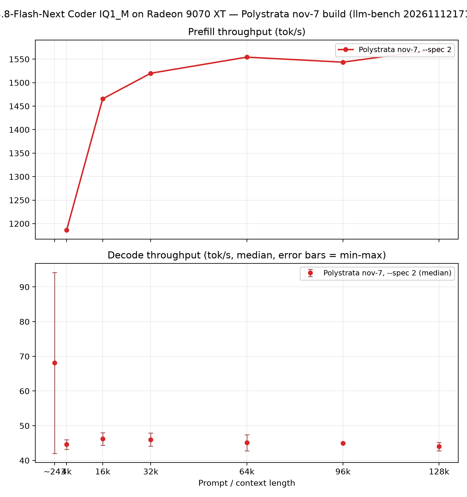

# Qwen3.8-Flash-Next "Coder" (IQ1_M) — Polystrata (Radeon 9070 XT)

A single-run benchmark of the Qwen3.8-Flash-Next **Coder** IQ1_M GGUF through
Polystrata, on the same machine as the Ornith sweep in [ORNITH1.5-35B-A3B.md](ORNITH1.5-35B-A3B.md).
The engine is a **nov-7 build of Polystrata** (0.1.45-poly.8 release line),
run with the MTP drafter and a 2-token verify window (`--spec 2`). The run
itself is dated 2026-11-12 17:19Z and tagged `Polystrata nov 7 QFN Coder
--spec2`.

## Sources

| Model | Hugging Face | Local name |
| --- | --- | --- |
| Coder, IQ1_M | [ISTA-DASLab/Qwen3.8-Flash-Next-GSQ-RCO-Coder-GGUF](https://huggingface.co/ISTA-DASLab/Qwen3.8-Flash-Next-GSQ-RCO-Coder-GGUF) | `qwen3.8-flash-next-coder-iq1_m` |

The Coder keeps 256 of each layer's 512 experts, chosen on code data (91% of
the full model's SWE-bench Verified score, 99% of LiveCodeBench, by its
authors); the file is one size — IQ1_M (experts stored like IQ3_S), shard 1
~29.6 GB. It is weaker outside code and for languages other than
English/CJK.

## Setup

- **Model:** Qwen3.8-Flash-Next "Coder" IQ1_M GGUF.
- **Engine:** Polystrata ([simplexai-labs/PolyStrata](https://github.com/simplexai-labs/PolyStrata)),
  binary built **2026-11-07/08** — `a721e9c4` is HEAD of that date and
  `0c898b9c` merges the next-release 0.1.45-poly.8; the run tag says "nov 7".
  (The Ornith runs in ORNITH1.5-35B-A3B.md used the newer `e4ea22a3` build, so absolute
  numbers are not directly comparable build-to-build.)
- **Speculation:** `--spec 2` — the MTP drafter proposes a 2-token verify
  window per check.
- **Bench tool / protocol:** same llm-bench protocol as the README (prefill at
  fixed prompt lengths 4k→128k, decode 512 tokens, 5 runs per size where
  possible, medians; same corpus, sha256 `58a7756f…`).

## Results

### Prefill, tok/s (TTFT s)

| Prompt length | Prefill tok/s | TTFT (s) | prompt_tokens | Note |
| ---: | ---: | ---: | ---: | --- |
| 4 000 | 1 186.1 | 3.62 | 4 291 | flagged: outside ±1% of reference 4 133 |
| 16 000 | 1 465.5 | 11.22 | 16 444 | |
| 32 000 | 1 520.0 | 21.61 | 32 848 | prompt_tokens unchecked |
| 64 000 | 1 554.3 | 42.16 | 65 531 | prompt_tokens unchecked |
| 96 000 | 1 543.6 | 63.92 | 98 667 | prompt_tokens unchecked |
| 128 000 | 1 571.6 | 82.17 | 129 139 | prompt_tokens unchecked |

The 4k prefill rows are marked invalid in the JSON: actual prompt tokens
4 290–4 292 vs the 4 133 reference for this model (~4% over the ±1% band);
treat its tps as slightly optimistic (more tokens per wall second).

### Decode, tok/s (median / min–max)

| Context length | Median | Min | Max | Runs |
| ---: | ---: | ---: | ---: | ---: |
| ~243 (short) | 68.1 | 42.0 | 70.0 | 5 |
| 4 000 | 44.6 | 43.2 | 46.2 | 5 |
| 16 000 | 46.2 | 44.4 | 49.5 | 5 |
| 32 000 | 46.0 | 44.1 | 47.5 | 5 |
| 64 000 | 45.1 | 42.8 | 46.2 | 5 |
| 96 000 | 45.0 | 45.0 | 45.1 | 2 |
| 128 000 | 44.0 | 42.8 | 45.1 | 2 |

## Notes and findings

- **Prefill is flat up top** — it climbs from 1 186 at 4k to ~1 520–1 554 at
  32k–64k and barely moves from there (1 544 at 96k, 1 572 at 128k). Steady
  TTFT at 128k of 82 s.
- **Decode is nearly flat across context** — it steps down from 68.1 short to
  ~45 tok/s above 4k, then holds 44.0–46.2 out to 128k (only ~93% retained).
  Wide flatness, in contrast to the Ornith Polystrata slope (93.9 → 41.1 short
  to 128k, ~56% drop, on the newer build).
- **Short-context decode straddles the rest** — the short (243-token prompt)
  decode is 68.1 median but one run hit 42.0 tok/s; the min–max band
  (42.0–70.0) overlaps the 45-ish plateau, so the "short boost" is ~50% on the
  median, not a lower bound.
- **Cross-machine reference:** Polystrata's own docs measure the same Coder
  IQ1_M on an RX 9070 XT / Ryzen 9 3900X / 47 GB machine at ~44 tok/s short,
  ~33 tok/s at 128k and ~1 420 tok/s prefill (32k prompt). This box (5700X3D,
  32 GB, nov-7 build, `--spec 2`) reads ~1 550 tok/s in that regime and decodes
  ~45 at 128k (~40% above the doc figure). Not a controlled comparison:
  different build, RAM (32 vs 47 GB changes the expert cache) and likely
  different spec setup.
- **Different model and quant than the sibling docs** — the Qwen3.6 and
  Ornith tables here run at EXL3/APEX I-QUALITY quants with ~35B-heavy expert
  traffic; IQ1_M Coder is a far smaller slice of the weights, so those
  numbers are not interchangeable with the ones above.

## Throughput graph

Prefill on top, decode below (median with min–max error bars; short-context
decode at the left edge).

Generated with [`plots/qfn_coder.py`](plots/qfn_coder.py)
(`uv run --with matplotlib python qfn_coder.py`).

## Caveats

- Single run: no `--spec 0` (no-spec) baseline for this model, no second
  quant, and the engine build (nov-7) differs from the Ornith runs (`e4ea22a3`,
  2026-11-10), so there is no clean Polystrata head-to-head in this repo yet.
- The 96k/128k decode medians rest on 2 runs each.
- 4k prefill rows flagged invalid (token count 4 290–4 292 vs reference 4 133);
  32k–128k prompt token counts unchecked (no reference for this model at those
  sizes).
- Coder keeps only half the experts: capacity, non-code and non-English/CJK
  quality are below the full model.

## Raw results

- `results/qwen-flash-next/polystrata-20261112T171930Z-qwen3-8-flash-next-coder-iq1-m.json`
  (also in `../llm-bench/results/` under its original name
  `20261112T171930Z-qwen3-8-flash-next-coder-iq1-m.json`)