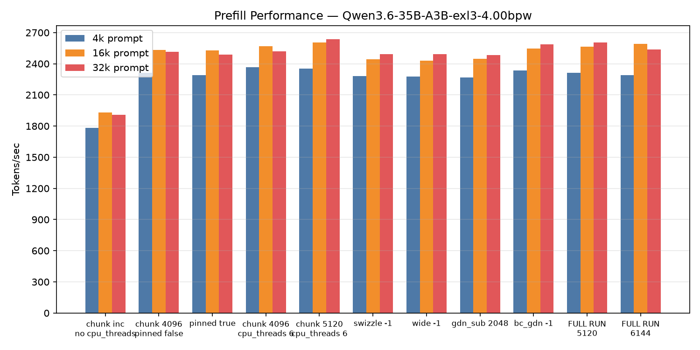
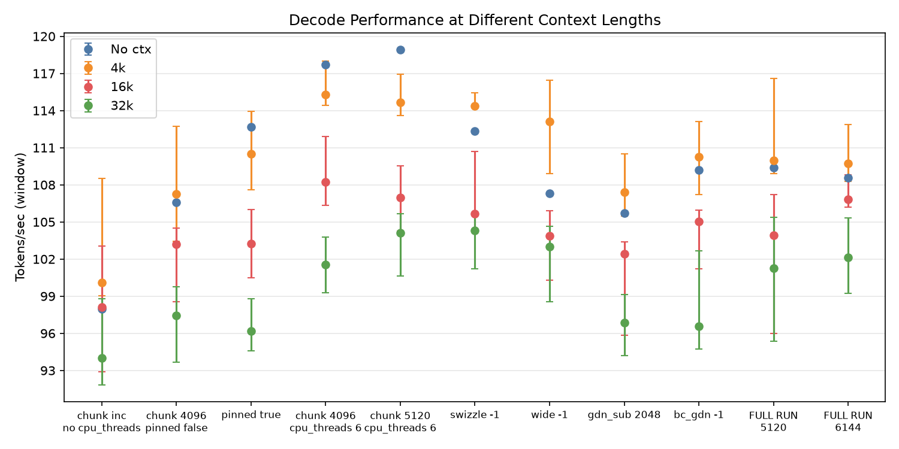
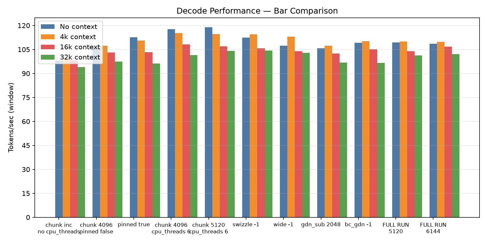
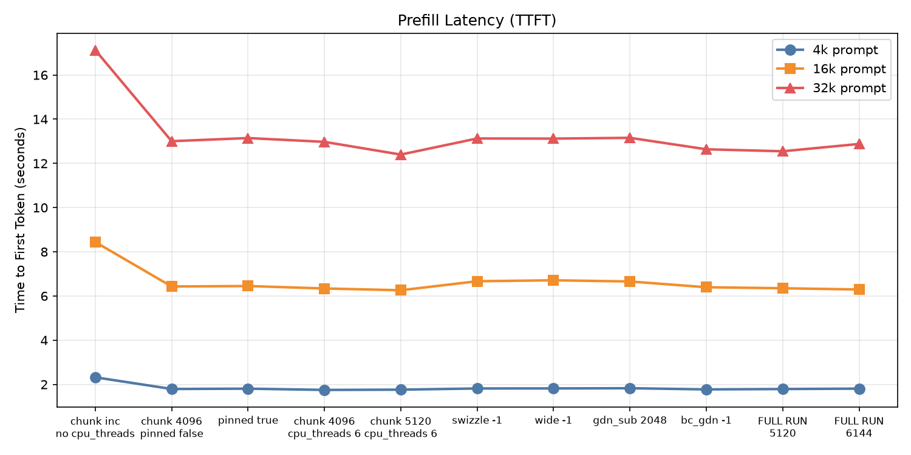

# Qwen3.6-35B-A3B Improvements

## Configuration

Each run has its own config directory under `configs/` with a `config.yml` and `run.sh`:

| Run | Directory | Key Differences |
|-----|-----------|-----------------|
| 1 | [configs/run1-chunk5120/](configs/run1-chunk5120/) | chunk_size 5120, pinned_arena false, vision_offload true, threads 7 |
| 2 | [configs/run2-chunk4096/](configs/run2-chunk4096/) | chunk_size 4096, pinned_arena false, vision_offload true, threads 7 |
| 3 | [configs/run3-pinned-true/](configs/run3-pinned-true/) | chunk_size 4096, pinned_arena **true**, vision_offload true |
| 4 | [configs/run4-no-vision-offload/](configs/run4-no-vision-offload/) | chunk_size 4096, pinned_arena false, vision_offload **false** |

All runs share `EXL3_QC_STAGING=1` and `EXL3_GDN_REPLAY=1`. Runs 2–4 were launched with `EXL3_MOE_CPU_STAGE_THREADS=6 ./serve/run_tabby.sh`.

---

## Latest Benchmark Results

### Run Summary

| # | Timestamp | Tag | Chunk Size | Pinned Arena | VRAM | Decode TPS (med) | Decode @4k (med) | Decode @16k (med) | Decode @32k (med) |
|---|-----------|-----|------------|--------------|------|------------------|------------------|-------------------|-------------------|
| 0 | 2026-11-15 11:27 | pinned experts false, chunk increase (no cpu_stage_threads) | — | false | — | 97.95 | 100.09 | 98.12 | 94.01 |
| 1 | 2026-11-15 12:04 | pinned experts false, chunk 5120, vision offload, cpu_stage_threads 6, threads 7 | 5120 | false | 14.7 GB | **118.94** | **114.67** | **106.98** | **104.13** |
| 2 | 2026-11-15 11:56 | pinned experts false, chunk 4096, vision offload, cpu_stage_threads 6, threads 7 | 4096 | false | 14.5 GB | 117.71 | 115.28 | 108.25 | 101.54 |
| 3 | 2026-11-15 11:50 | pinned experts true, chunk 4096, vision offload | 4096 | true | 13.5 GB | 112.67 | 110.51 | 103.24 | 96.18 |
| 4 | 2026-11-15 11:44 | pinned experts false, chunk 4096 | 4096 | false | — | 106.59 | 107.27 | 103.19 | 97.45 |
| 5 | 2026-11-15 12:27 | pinned experts false, chunk 5120, vision offload, cpu_stage_threads 6, threads 7, **swizzle -1** | 5120 | false | 14.7 GB | 112.36 | 114.36 | 105.67 | 104.29 |
| 6 | 2026-11-15 12:37 | pinned experts false, chunk 5120, vision offload, cpu_stage_threads 6, threads 7, **wide -1** | 5120 | false | 14.7 GB | 107.31 | 113.13 | 103.87 | 102.98 |
| 7 | 2026-11-15 12:45 | pinned experts false, chunk 5120, vision offload, cpu_stage_threads 6, threads 7, **gdn_sub_chunk 2048** | 5120 | false | 14.7 GB | 105.73 | 107.40 | 102.42 | 96.85 |
| 8 | 2026-11-15 12:52 | pinned experts false, chunk 5120, vision offload, cpu_stage_threads 6, threads 7, **bc_gdn -1** | 5120 | false | 14.7 GB | 109.18 | 110.24 | 105.05 | 96.58 |
| 9 | 2026-11-15 12:59 | pinned experts false, chunk 5120, vision offload, cpu_stage_threads 6, threads 7, **FULL RUN** (4k→128k), MTP (2) | 5120 | false | 14.7 GB | 109.37 | 109.97 | 103.90 | 101.28 |
| 10 | 2026-11-17 09:59 | pinned experts false, chunk 6144, vision offload, cpu_stage_threads 6, threads 7, **FULL RUN** (4k→128k), MTP (2) | **6144** | false | 15 GB | 108.56 | 109.73 | 106.81 | 102.15 |

> **Run 10 (2026-11-17 09:59) power & VRAM:** GPU at ~260 W, VRAM max ~15.3 GB.
>
> Note on MTP: Runs 9 and 10 actually ran with **MTP speculation (2 draft
> tokens)** — the run tags don’t mention a drafter because only the external
> draft model was absent. The earlier "no-spec / no drafter" label on the
> winner charts has been corrected to "MTP (2)".

### Prefill Performance (tokens/sec)

| # | 4k TPS | 4k TTFT (s) | 16k TPS | 16k TTFT (s) | 32k TPS | 32k TTFT (s) |
|---|--------|-------------|---------|--------------|---------|--------------|
| 0 | 1784 | 2.32 | 1930 | 8.44 | 1909 | 17.13 |
| 1 | 2351 | 1.76 | 2603 | 6.26 | 2637 | 12.40 |
| 2 | 2367 | 1.75 | 2570 | 6.34 | 2520 | 12.97 |
| 3 | 2292 | 1.81 | 2526 | 6.45 | 2487 | 13.15 |
| 4 | 2312 | 1.79 | 2534 | 6.43 | 2514 | 13.00 |
| 5 | 2280 | 1.82 | 2444 | 6.67 | 2491 | 13.13 |
| 6 | 2279 | 1.82 | 2428 | 6.71 | 2492 | 13.12 |
| 7 | 2268 | 1.83 | 2448 | 6.66 | 2485 | 13.16 |
| 8 | 2335 | 1.77 | 2547 | 6.40 | 2587 | 12.64 |
| 9 | 2314 | 1.79 | 2566 | 6.35 | 2606 | 12.55 |
| 10 | 2291 | 1.81 | 2589 | 6.29 | 2539 | 12.88 |

### Decode Performance (tokens/sec)

#### No Context (short prompt)

| # | Min | Median | Max |
|---|-----|--------|-----|
| 0 | 96.45 | 97.95 | 106.73 |
| 1 | 112.12 | **118.94** | 121.97 |
| 2 | 112.88 | 117.71 | 120.67 |
| 3 | 105.60 | 112.67 | 114.65 |
| 4 | 103.66 | 106.59 | 109.75 |
| 5 | 105.48 | 112.36 | 113.36 |
| 6 | 102.59 | 107.31 | 114.93 |
| 7 | 95.13 | 105.73 | 109.25 |
| 8 | 102.07 | 109.18 | 115.38 |
| 9 | 105.09 | 109.37 | 115.80 |
| 10 | 102.87 | 108.56 | 110.01 |

#### Decode at Context Length

| # | Context | Min | Median | Max |
|---|---------|-----|--------|-----|
| 0 | 4k | 99.05 | 100.09 | 108.53 |
| 1 | 4k | 113.61 | **114.67** | 116.91 |
| 2 | 4k | 114.43 | 115.28 | 117.99 |
| 3 | 4k | 107.61 | 110.51 | 113.93 |
| 4 | 4k | 103.46 | 107.27 | 112.73 |
| 5 | 4k | 114.21 | 114.36 | 115.44 |
| 6 | 4k | 108.91 | 113.13 | 116.46 |
| 7 | 4k | 105.45 | 107.40 | 110.48 |
| 8 | 4k | 107.23 | 110.24 | 113.09 |
| 9 | 4k | 108.92 | 109.97 | 116.59 |
| 10 | 4k | 108.26 | 109.73 | 112.85 |
| 1 | 16k | 104.27 | **106.98** | 109.52 |
| 2 | 16k | 106.34 | 108.25 | 111.90 |
| 3 | 16k | 100.51 | 103.24 | 105.98 |
| 4 | 16k | 98.55 | 103.19 | 104.52 |
| 5 | 16k | 104.39 | 105.67 | 110.71 |
| 6 | 16k | 100.32 | 103.87 | 105.92 |
| 7 | 16k | 95.82 | 102.42 | 103.39 |
| 8 | 16k | 101.23 | 105.05 | 105.94 |
| 9 | 16k | 95.99 | 103.90 | 107.20 |
| 10 | 16k | 106.18 | 106.81 | 108.82 |
| 0 | 16k | 92.88 | 98.12 | 103.04 |
| 1 | 32k | 100.64 | **104.13** | 105.69 |
| 2 | 32k | 99.26 | 101.54 | 103.79 |
| 3 | 32k | 94.58 | 96.18 | 98.79 |
| 4 | 32k | 93.66 | 97.45 | 99.75 |
| 5 | 32k | 101.19 | 104.29 | 105.66 |
| 6 | 32k | 98.57 | 102.98 | 104.64 |
| 7 | 32k | 94.21 | 96.85 | 99.14 |
| 8 | 32k | 94.73 | 96.58 | 102.67 |
| 9 | 32k | 95.38 | 101.28 | 105.36 |
| 10 | 32k | 99.23 | 102.15 | 105.32 |
| 0 | 32k | 91.84 | 94.01 | 98.80 |

---

## Raw Data

Full benchmark JSONs are stored in the `results/` directory:

| # | File | Tag |
|---|------|-----|
| # | File | Tag |
|---|------|-----|
| 0 | [results/20261115T112713Z-qwen3-6-35b-a3b-exl3-4-00bpw.json](results/qwen/20261115T112713Z-qwen3-6-35b-a3b-exl3-4-00bpw.json) | pinned experts false, chunk increase (no cpu_stage_threads) |
| 1 | [results/20261115T114428Z-qwen3-6-35b-a3b-exl3-4-00bpw.json](results/qwen/20261115T114428Z-qwen3-6-35b-a3b-exl3-4-00bpw.json) | pinned experts false, chunk 4096 |
| 2 | [results/20261115T115017Z-qwen3-6-35b-a3b-exl3-4-00bpw.json](results/qwen/20261115T115017Z-qwen3-6-35b-a3b-exl3-4-00bpw.json) | pinned experts true, chunk 4096, vision offload |
| 3 | [results/20261115T115658Z-qwen3-6-35b-a3b-exl3-4-00bpw.json](results/qwen/20261115T115658Z-qwen3-6-35b-a3b-exl3-4-00bpw.json) | pinned experts false, chunk 4096, vision offload, cpu_stage_threads 6, threads 7 |
| 4 | [results/20261115T120402Z-qwen3-6-35b-a3b-exl3-4-00bpw.json](results/qwen/20261115T120402Z-qwen3-6-35b-a3b-exl3-4-00bpw.json) | pinned experts false, chunk 5120, vision offload, cpu_stage_threads 6, threads 7 |
| 5 | [results/20261115T122705Z-qwen3-6-35b-a3b-exl3-4-00bpw.json](results/qwen/20261115T122705Z-qwen3-6-35b-a3b-exl3-4-00bpw.json) | pinned experts false, chunk 5120, vision offload, cpu_stage_threads 6, threads 7, swizzle -1 |
| 6 | [results/20261115T123728Z-qwen3-6-35b-a3b-exl3-4-00bpw.json](results/qwen/20261115T123728Z-qwen3-6-35b-a3b-exl3-4-00bpw.json) | pinned experts false, chunk 5120, vision offload, cpu_stage_threads 6, threads 7, wide -1 |
| 7 | [results/20261115T124540Z-qwen3-6-35b-a3b-exl3-4-00bpw.json](results/qwen/20261115T124540Z-qwen3-6-35b-a3b-exl3-4-00bpw.json) | pinned experts false, chunk 5120, vision offload, cpu_stage_threads 6, threads 7, gdn_sub_chunk 2048 |
| 8 | [results/20261115T125239Z-qwen3-6-35b-a3b-exl3-4-00bpw.json](results/qwen/20261115T125239Z-qwen3-6-35b-a3b-exl3-4-00bpw.json) | pinned experts false, chunk 5120, vision offload, cpu_stage_threads 6, threads 7, bc_gdn -1 |
| 9 | [results/20261115T125911Z-qwen3-6-35b-a3b-exl3-4-00bpw.json](results/qwen/20261115T125911Z-qwen3-6-35b-a3b-exl3-4-00bpw.json) | pinned experts false, chunk 5120, vision offload, cpu_stage_threads 6, threads 7, FULL RUN (4k→128k), MTP (2) |
| 10 | [results/20261117T095948Z-qwen3-6-35b-a3b-exl3-4-00bpw.json](results/qwen/20261117T095948Z-qwen3-6-35b-a3b-exl3-4-00bpw.json) | pinned experts false, chunk 6144, vision offload, cpu_stage_threads 6, threads 7, FULL RUN (4k→128k), MTP (2) |

---

## Graphs

### Prefill TPS

### Decode at Context Lengths

### Decode Bar Comparison

### Prefill TTFT

---

*Generated by `plots/generate_graphs.py` from results in `/home/willyhetland/Storage/code/llm-bench/results/`*