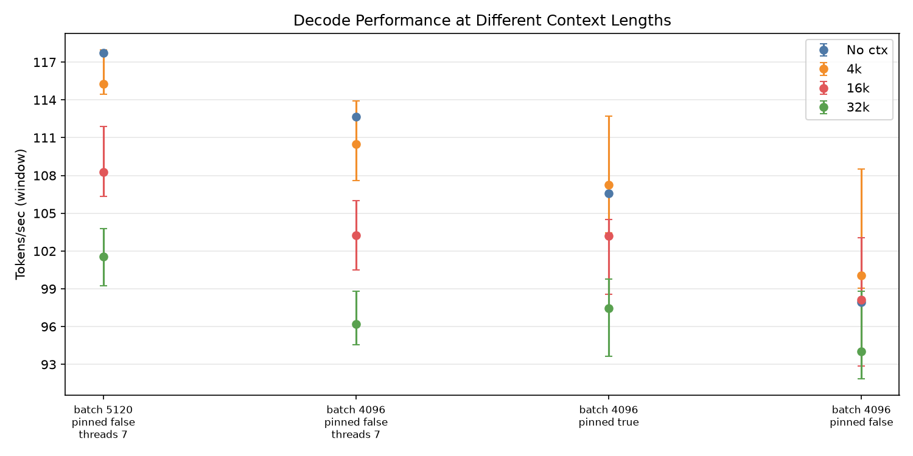
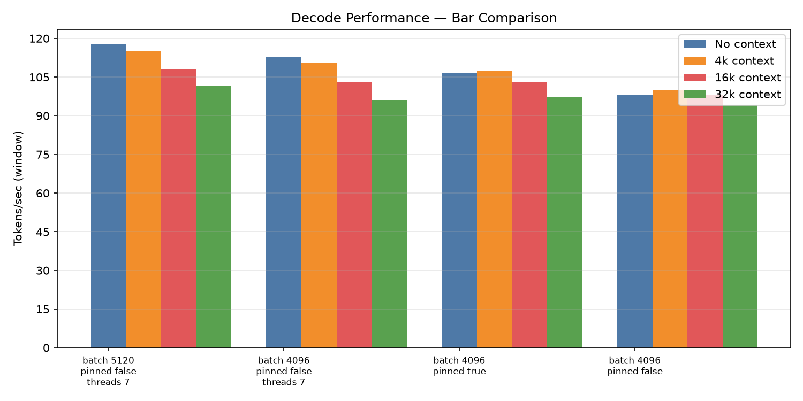
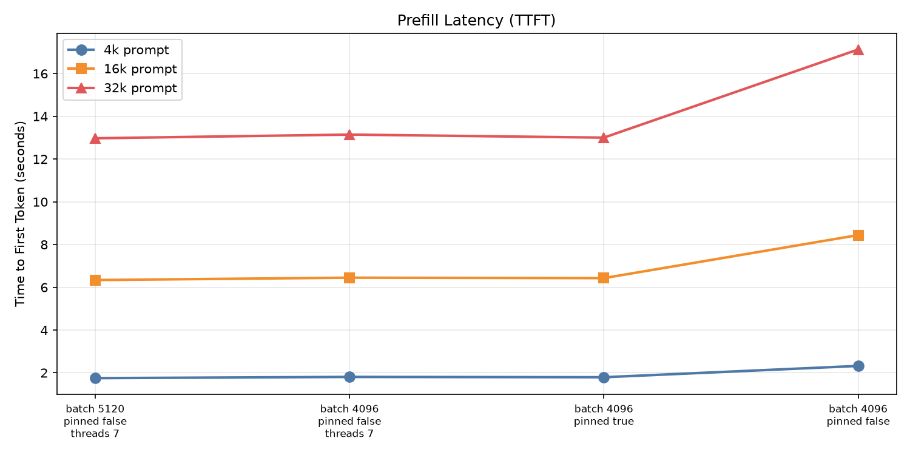

# Qwen3.6-35B-A3B Improvements

## Configuration

Each run has its own config directory under `configs/` with a `config.yml` and `run.sh`:

| Run | Directory | Key Differences |
|-----|-----------|-----------------|
| 1 | [configs/run1-batch5120/](configs/run1-batch5120/) | chunk_size 5120, pinned_arena false, vision_offload true, threads 7 |
| 2 | [configs/run2-batch4096/](configs/run2-batch4096/) | chunk_size 4096, pinned_arena false, vision_offload true, threads 7 |
| 3 | [configs/run3-pinned-true/](configs/run3-pinned-true/) | chunk_size 4096, pinned_arena **true**, vision_offload true |
| 4 | [configs/run4-no-vision-offload/](configs/run4-no-vision-offload/) | chunk_size 4096, pinned_arena false, vision_offload **false** |

All runs share `EXL3_QC_STAGING=1` and `EXL3_GDN_REPLAY=1`. Runs 2–4 were launched with `EXL3_MOE_CPU_STAGE_THREADS=6 ./serve/run_tabby.sh`.

---

## Latest Benchmark Results

### Run Summary

| # | Timestamp | Tag | Chunk Size | Pinned Arena | VRAM | Decode TPS (med) | Decode @4k (med) | Decode @16k (med) | Decode @32k (med) |
|---|-----------|-----|------------|--------------|------|------------------|------------------|-------------------|-------------------|
| 1 | 2026-11-15 12:04 | pinned experts false, batch 5120, vision offload, cpu_stage_threads 6, threads 7 | 5120 | false | 14.7 GB | **118.94** | **114.67** | **106.98** | **104.13** |
| 2 | 2026-11-15 11:56 | pinned experts false, batch 4096, vision offload, cpu_stage_threads 6, threads 7 | 4096 | false | 14.5 GB | 117.71 | 115.28 | 108.25 | 101.54 |
| 3 | 2026-11-15 11:50 | pinned experts true, batch 4096, vision offload | 4096 | true | 13.5 GB | 112.67 | 110.51 | 103.24 | 96.18 |
| 4 | 2026-11-15 11:44 | pinned experts false, batch 4096 | 4096 | false | — | 106.59 | 107.27 | 103.19 | 97.45 |

> **Last run (Run 1) power & VRAM:** GPU at ~200–250 W, CPU at ~50 W, total VRAM ~15.3 GB.

### Prefill Performance (tokens/sec)

| # | 4k TPS | 4k TTFT (s) | 16k TPS | 16k TTFT (s) | 32k TPS | 32k TTFT (s) |
|---|--------|-------------|---------|--------------|---------|--------------|
| 1 | 2351 | 1.76 | 2603 | 6.26 | 2637 | 12.40 |
| 2 | 2367 | 1.75 | 2570 | 6.34 | 2520 | 12.97 |
| 3 | 2292 | 1.81 | 2526 | 6.45 | 2487 | 13.15 |
| 4 | 2312 | 1.79 | 2534 | 6.43 | 2514 | 13.00 |

### Decode Performance (tokens/sec)

#### No Context (short prompt)

| # | Min | Median | Max |
|---|-----|--------|-----|
| 1 | 112.12 | **118.94** | 121.97 |
| 2 | 112.88 | 117.71 | 120.67 |
| 3 | 105.60 | 112.67 | 114.65 |
| 4 | 103.66 | 106.59 | 109.75 |

#### Decode at Context Length

| # | Context | Min | Median | Max |
|---|---------|-----|--------|-----|
| 1 | 4k | 113.61 | **114.67** | 116.91 |
| 2 | 4k | 114.43 | 115.28 | 117.99 |
| 3 | 4k | 107.61 | 110.51 | 113.93 |
| 4 | 4k | 103.46 | 107.27 | 112.73 |
| 1 | 16k | 104.27 | **106.98** | 109.52 |
| 2 | 16k | 106.34 | 108.25 | 111.90 |
| 3 | 16k | 100.51 | 103.24 | 105.98 |
| 4 | 16k | 98.55 | 103.19 | 104.52 |
| 1 | 32k | 100.64 | **104.13** | 105.69 |
| 2 | 32k | 99.26 | 101.54 | 103.79 |
| 3 | 32k | 94.58 | 96.18 | 98.79 |
| 4 | 32k | 93.66 | 97.45 | 99.75 |

---

## Raw Data

Full benchmark JSONs are stored in the `results/` directory:

| # | File | Tag |
|---|------|-----|
| 1 | [results/20261115T120402Z-qwen3-6-35b-a3b-exl3-4-00bpw.json](results/20261115T120402Z-qwen3-6-35b-a3b-exl3-4-00bpw.json) | pinned experts false, batch 5120, vision offload, cpu_stage_threads 6, threads 7 |
| 2 | [results/20261115T115658Z-qwen3-6-35b-a3b-exl3-4-00bpw.json](results/20261115T115658Z-qwen3-6-35b-a3b-exl3-4-00bpw.json) | pinned experts false, batch 4096, vision offload, cpu_stage_threads 6, threads 7 |
| 3 | [results/20261115T115017Z-qwen3-6-35b-a3b-exl3-4-00bpw.json](results/20261115T115017Z-qwen3-6-35b-a3b-exl3-4-00bpw.json) | pinned experts true, batch 4096, vision offload |
| 4 | [results/20261115T114428Z-qwen3-6-35b-a3b-exl3-4-00bpw.json](results/20261115T114428Z-qwen3-6-35b-a3b-exl3-4-00bpw.json) | pinned experts false, batch 4096 |

---

## Graphs

### Prefill TPS

### Decode at Context Lengths

### Decode Bar Comparison

### Prefill TTFT

---

*Generated by `generate_graphs.py` from results in `/home/willyhetland/Storage/code/llm-bench/results/`*