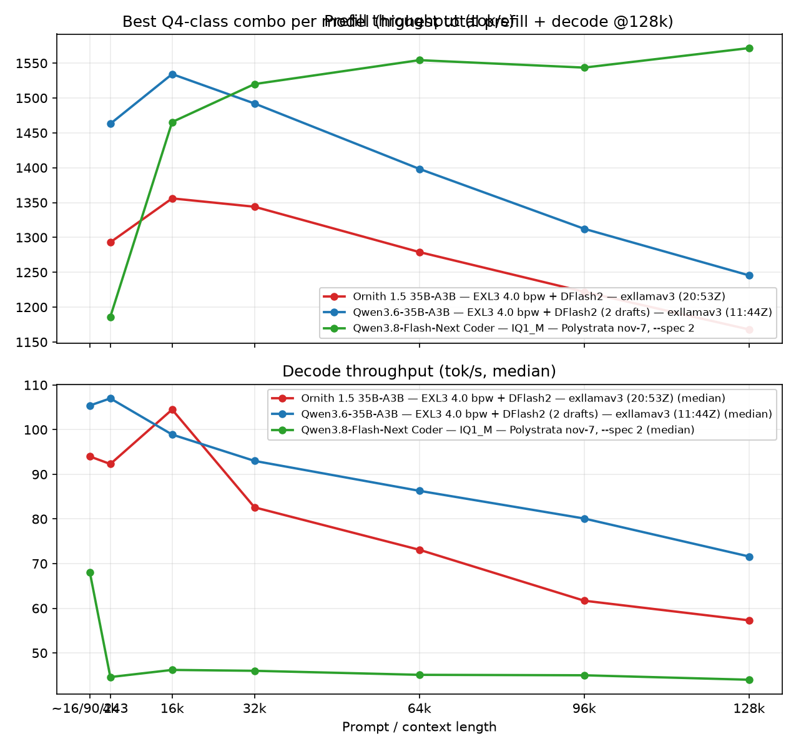

# Exploring MoE CPU offloading and hot cache experts

Exploring MoE expert CPU offloading and hot expert caches across different
inference engines on RDNA4 (Radeon 9070 XT).

## Goal

Run MoE models that do **not** fit in the GPU's 16 GB of VRAM at **at least
128K context**, with **prefill over 1 500 tok/s** and **decode over 100 tok/s**.
The idea is to offload some experts to CPU with as small a performance hit as
possible — it will obviously never match a fully GPU-resident model, but the
goal is to stay in the same ballpark. Everything here is on the lesser-optimized
AMD ROCm stack, where the gap between systems is widest.

Decisions already made along the way:

- Main KV cache at Q8 to leave VRAM headroom; draft cache at Q4.
- CPU-resident experts are the offload unit (llama.cpp `--n-cpu-moe`, exllamav3
  `cpu_moe_split_experts`), with per-engine hot-expert caches where available.

### Notable findings so far

- **Polystrata/Strata pegs the GPU hardest** — it runs the 9070 XT at its
  power limit (300 W), while llama.cpp and exllamav3 only reach ~150–200 W.
  Despite that, the CPU-side decode speed is not noticeably worse than on
  Polystrata/Strata, so llama.cpp/exllamav3 deliver the best absolute
  watts-per-token.
- **On the original Strata engine, throughput degrades badly as context
  grows** for the heavier models (Ornith Polystrata prefill falls 1 723 →
  709 tok/s from 4k→128k; Strata Unsloth Qwen3.6 decode collapses 59.4 → 9.3
  tok/s over the same range). The Flash Next Coder keeping a consistent ~1 550
  tok/s prefill all the way to 128k is quite impressive in comparison.
- **Cache tweaks help only modestly**: llama.cpp's 4 096 MiB hot-expert cache
  (`--moe-cache-mib`) gives small gains (decode holds to ~16k before falling
  off), and the CPU-decode share flag (`--moe-cache-cpu-share`) did not
  improve decode noticeably — numbers in [moe-cache.md](moe-cache.md).

## System

| Component | Spec |
| --- | --- |
| OS | `7.3.1-1-cachyos #1 SMP PREEMPT_DYNAMIC Sat, 31 Oct 2026 15:33:05 +0000 x86_64 GNU/Linux` |
| CPU | AMD Ryzen 7 5700X3D (8c/16t) |
| RAM | 32 GB DDR4-3200 (4 × 8 GB) |
| GPU | Gigabyte Radeon 9070 XT Gaming OC (power limit 300 W) |

## Scope

Per-model results live in their own files:

- **Ornith 1.5 35B-A3B** (~35B params, MoE) across llama.cpp (APEX GGUF),
  exllamav3 (EXL3) and Polystrata (APEX GGUF), different quantizations per
  engine — configs, results, findings and raw runs in
  [ORNITH1.5-35B-A3B.md](ORNITH1.5-35B-A3B.md).
- **Qwen3.8-Flash-Next "Coder"** (IQ1_M, Polystrata, nov-7 build, `--spec 2`),
  single run — see [QWEN3.8-FLASH_NEXT.md](QWEN3.8-FLASH_NEXT.md).
- **Qwen3.6-35B-A3B** EXL3 quants and GGUF runs — see
  [QWEN3.6-35B-A3B.md](QWEN3.6-35B-A3B.md).

### Bench protocol

- **Bench tool:** [willeyh-git/llm-bench](https://github.com/willeyh-git/llm-bench) (Go, commit `f5de163`).
  It drives each engine's OpenAI-compatible server through the protocol below;
  JSON results land in `results/`.
- **Bench protocol:** prefill at fixed prompt lengths (4k, 16k, 32k, 64k, 96k, 128k
  targets), then decode (512 tokens) at short context and at each prefill length
  (prompt already cached). 5 runs per size where possible; medians reported. One
  shared corpus (sha256 `58a7756f…`).
- **Hot expert cache mechanism differs per engine** — see the per-model files
  and the engine config docs.

Engine config docs: [`LLAMA_CPP_CONF.md`](LLAMA_CPP_CONF.md),
[`EXLLAMAV3_CONF.md`](EXLLAMAV3_CONF.md), [`POLYSTRATA_CONF.md`](POLYSTRATA_CONF.md).

## Best ~Q4 engine combo per model at 128k

Same layout as the per-model plots — prefill on top, decode below — with one
line per model: the winning combo only (highest total of prefill + decode at
128k, among runs that reached 128k). No other engines are plotted.
Q4-class quants for Ornith (APEX GGUF / EXL3 4.00 bpw) and Qwen3.6 (EXL3 4.00
bpw / UD Q4_K_XL GGUF); QFn Coder is IQ1_M, included for reference.

| Model | Winner (quant / engine) | Prefill @128k | Decode @128k |
| --- | --- | ---: | ---: |
| Ornith 1.5 35B-A3B | EXL3 4.0 bpw, DFlash2 / exllamav3 | 1 168 tok/s | 57.3 tok/s |
| Qwen3.6-35B-A3B | EXL3 4.0 bpw, DFlash2 (2 drafts) / exllamav3 | 1 246 tok/s | 71.6 tok/s |
| Qwen3.8-Flash-Next Coder | IQ1_M / Polystrata nov-7 `--spec 2` | 1 572 tok/s | 44.0 tok/s |

Excluded for not reaching 128k: llama.cpp Qwen3.6 runs and the exllamav3
short-range Qwen3.6 runs (~32k max). QFn Coder has a single eligible run, so
it is its own winner by default.

Generated with [`plots/best_q4_128k.py`](plots/best_q4_128k.py)
(`uv run --with matplotlib python best_q4_128k.py`).

## Raw results (master list)

JSON files live under `results/`, grouped by model. Full annotations are in the
per-model files.

### `results/ornith/` — Ornith 1.5 35B-A3B (9 files)

See [ORNITH1.5-35B-A3B.md](ORNITH1.5-35B-A3B.md) — canonical, superseded and
stale runs annotated there.

### `results/qwen/` — Qwen3.6-35B-A3B (17 files)

- `20261112T155239Z-qwen3-6-35b-a3b-ud-q4-k-xl.json` (UD Q4_K_XL, PolyStrata)
- `20261112T151400Z-qwen3-6-35b-a3b-ud-q4-k-xl.json` (UD Q4_K_XL, Strata Unsloth build)
- `20261112T134157Z-qwen-3-6-q4-llama.json` (llama.cpp no-drafter)
- `20261112T132841Z-qwen-3-6-q4-llama.json` (llama.cpp MTP)
- 13 × `exllamav3-20261112T…-q{4,5,6}-exl3-*.json` (EXL3 4.00/5.00/6.00 bpw; no-spec /
  MTP / DFlash2 short-range runs plus 2-draft asides)

See [QWEN3.6-35B-A3B.md](QWEN3.6-35B-A3B.md) for the full annotated list.

### `results/qwen-flash-next/` — Qwen3.8-Flash-Next (1 file)

- `polystrata-20261112T171930Z-qwen3-8-flash-next-coder-iq1-m.json` (Coder IQ1_M, Polystrata nov-7 build, `--spec 2` — [QWEN3.8-FLASH_NEXT.md](QWEN3.8-FLASH_NEXT.md))