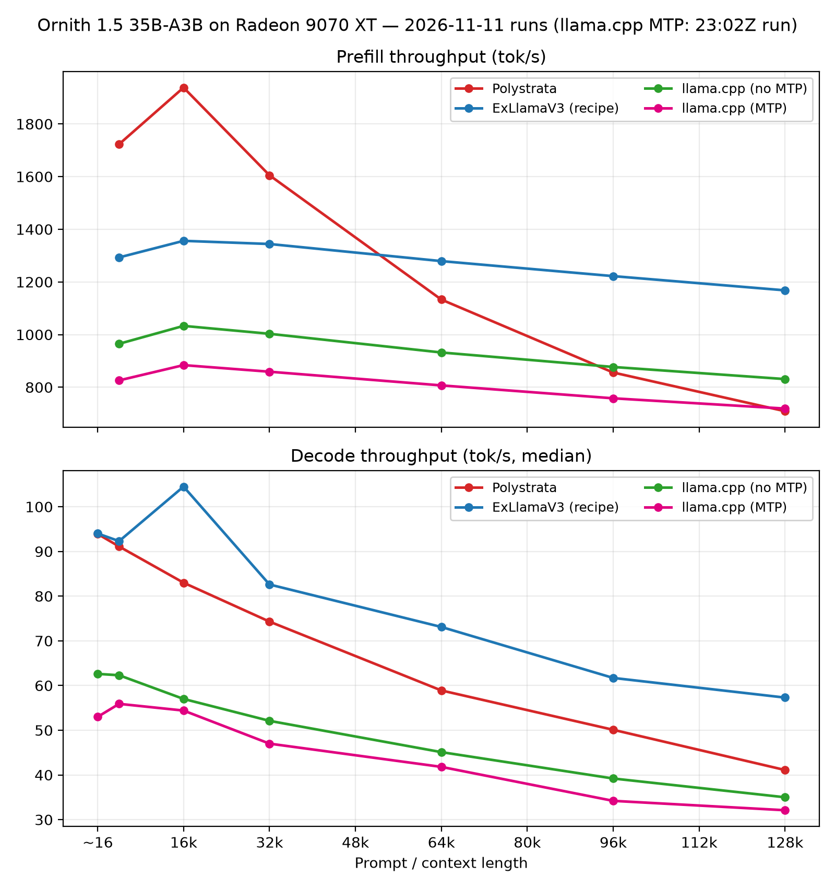

# Exploring MoE CPU offloading and hot cache experts

Exploring MoE expert CPU offloading and hot expert caches across different
inference engines on RDNA4 (Radeon 9070 XT).

## System

| Component | Spec |
| --- | --- |
| OS | `7.3.1-1-cachyos #1 SMP PREEMPT_DYNAMIC Sat, 31 Oct 2026 15:33:05 +0000 x86_64 GNU/Linux` |
| CPU | AMD Ryzen 7 5700X3D (8c/16t) |
| RAM | 32 GB DDR4-3200 (4 × 8 GB) |
| GPU | Gigabyte Radeon 9070 XT Gaming OC (power limit 300 W) |

## Scope

- **Model:** Ornith 1.5 35B-A3B (~35B params, MoE), different quantizations per engine.
- **Engines:** llama.cpp (APEX GGUF), exllamav3 (EXL3), Polystrata (APEX GGUF).
- **Bench tool:** [willeyh-git/llm-bench](https://github.com/willeyh-git/llm-bench) (Go, commit `f5de163`).
  It drives each engine's OpenAI-compatible server through the protocol below;
  JSON results land in `results/`.
- **Bench protocol:** prefill at fixed prompt lengths (4k, 16k, 32k, 64k, 96k, 128k
  targets), then decode (512 tokens) at short context and at each prefill length
  (prompt already cached). 5 runs per size where possible; medians reported. One
  shared corpus (sha256 `58a7756f…`). Runs dated 2026-11-11.
- **Hot expert cache mechanism differs per engine** — see configs below.

### Models

| Engine | Quantization |
| --- | --- |
| llama.cpp, Polystrata | APEX MTP GGUF — [mudler/Ornith-1.5-35B-A3B-APEX-MTP-GGUF](https://huggingface.co/mudler/Ornith-1.5-35B-A3B-APEX-MTP-GGUF) (quality file: `Ornith-1.5-35B-A3B-APEX-MTP-Quality.gguf`) |
| exllamav3 | [JRamirez-UAB/Ornith-1.5-35B-A3B-EXL3-4.00bpw-24GB](https://huggingface.co/JRamirez-UAB/Ornith-1.5-35B-A3B-EXL3-4.00bpw-24GB); DFlash2 draft requanted to EXL3 (3.0 bpw) from [jzinno/Ornith-1.5-35B-A3B-DFlash2](https://huggingface.co/jzinno/Ornith-1.5-35B-A3B-DFlash2) |

## Config summary

| Engine | Model file | GPU offload / expert offload | KV cache | Context | Sampling |
| --- | --- | --- | --- | --- | --- |
| llama.cpp (no MTP) | Ornith-1.5-35B-A3B-APEX GGUF | `-fa on`, `--n-cpu-moe 25`, `--moe-cache-mib 4096` (hot expert cache) | q8_0 k/v | 131 072 | T 0.6, top-p 0.95, top-k 20, min-p 0 |
| llama.cpp (MTP) | same + MTP drafts | `-fa on`, `--n-cpu-moe 30`, `--moe-cache-mib 4096`, `--spec-type draft-mtp,ngram-mod`, draft q4_0 k/v, up to 3 draft tokens | q8_0 k/v | 131 072 | same |
| exllamav3 | Ornith-1.5-35B-A3B-EXL3 4.00 bpw (24 GB) | `gpu_split_auto`, `cpu_moe_split_experts: 100` (100 experts resident on CPU) | Q8, 130 816 tokens, 768 MB autosplit reserve | 130 816 | same; spec draft: DFlash2 EXL3 3.0 bpw, 4 draft tokens, dynamic |
| Polystrata | Ornith-1.5-35B-A3B-APEX-I-QUALITY GGUF + `expert-profile.txt` | expert profile + hot cache (`STRATA_RESIDENT_PIN=0`, `STRATA_ROUTE_TAIL_SKIP=0`) | `--kv-whole` | 131 072 | same |

Full configs: [`LLAMA_CPP_CONF.md`](LLAMA_CPP_CONF.md),
[`EXLLAMAV3_CONF.md`](EXLLAMAV3_CONF.md), [`POLYSTRATA_CONF.md`](POLYSTRATA_CONF.md).

llama.cpp flag --moe-cache-cpu-share is not provided. Saw no immediate gains, see moe-cache-mib.md for numbers. 

### Engine binaries / sources

| Engine | Source | Commit used |
| --- | --- | --- |
| llama.cpp | [ggml-org/llama.cpp](https://github.com/ggml-org/llama.cpp) (ROCm build, `BUILD-ROCM.sh`) | `f7b886fe` (2026-11-11) |
| Polystrata | [simplexai-labs/PolyStrata](https://github.com/simplexai-labs/PolyStrata) | `e4ea22a3` (2026-11-10) |
| exllamav3 | fork [willeyh-git/exl3-rdna4-recipe](https://github.com/willeyh-git/exl3-rdna4-recipe) (forked from [parth-thakre/exl3-rdna4-recipe](https://github.com/parth-thakre/exl3-rdna4-recipe)) | `fe77c7b4` (2026-11-02, fork base, ExLlamaV3 v1.6.6) |

## Results

### Prefill (tok/s, TTFT s)

| Prompt length | llama.cpp no-MTP | llama.cpp MTP | exllamav3 | Polystrata |
| ---: | ---: | ---: | ---: | ---: |
| 4 000 | 965 (4.29) | 826 (5.01) | 1 293 (3.20) | **1 723 (2.40)** |
| 16 000 | 1 033 (15.78) | 884 (18.44) | 1 356 (12.02) | **1 938 (8.41)** |
| 32 000 | 1 003 (32.61) | 859 (38.07) | 1 344 (24.32) | **1 605 (20.38)** |
| 64 000 | 932 (70.17) | 807 (81.00) | **1 279 (51.11)** | 1 133 (57.72) |
| 96 000 | 877 (112.30) | 758 (129.95) | **1 222 (80.65)** | 856 (115.10) |
| 128 000 | 831 (155.25) | 719 (179.31) | **1 168 (110.41)** | 709 (181.93) |

### Decode, tok/s (median over runs)

| Context length | llama.cpp no-MTP | llama.cpp MTP | exllamav3 | Polystrata |
| ---: | ---: | ---: | ---: | ---: |
| ~16 (short) | 62.6 | 53.0 | **94.0** | 93.9 |
| 4 000 | 62.3 | 55.9 | **92.3** | 91.1 |
| 16 000 | 57.0 | 54.4 | **104.5** | 83.0 |
| 32 000 | 52.1 | 47.0 | **82.6** | 74.3 |
| 64 000 | 45.1 | 41.8 | **73.1** | 58.9 |
| 96 000 | 39.2 | 34.2 | **61.7** | 50.1 |
| 128 000 | 35.0 | 32.1 | **57.3** | 41.1 |

"-" = not run. The llama.cpp MTP column is the current 23:02Z run (full 4k–128k).
exllamav3 figures are the canonical 20:53Z run; its 32k decode
median includes two early-stop runs (244/245 tokens). llama.cpp's 96k decode
comes from two early-stop runs (140/170 tokens), its only such context this run.

### Throughput vs. context length

Linear axes; short-context decode (prompt ~16 tok) plotted at the left edge.
Generated with `plots/make_plots.py` (`python3` + matplotlib).

## Findings so far

1. **Short context: exllamav3 and Polystrata are effectively tied** — 94.0 vs
   93.9 tok/s short-context decode, 92.3 vs 91.1 at 4k, with the 94.0/92.3 edge in
   exllamav3. Polystrata keeps the strongest prefill at short prompts (1 723 tok/s
   at 4k, 1 938 at 16k).
2. **Long-context decode is exllamav3's, by a widening margin.** Its slope is the
   flattest (94.0 → 57.3 at 128k, ~39% drop) and it leads from 16k on (104.5 vs
   83.0) through 128k (57.3 vs 41.1). Polystrata has the steepest slope (93.9 →
   41.1, ~56% drop), consistent with its KV-heavy `--kv-whole` policy at long
   context. llama.cpp is the slowest decode at every context (62.6 → 35.0), with
   a mid slope (~44% drop).
3. **Prefill scaling:** exllamav3 is the best prefill from 64k up (1 279 →
   1 168, very flat) and second at 4k–32k; Polystrata leads 4k–32k (1 723 /
   1 938 / 1 605) but degrades to 709 at 128k; llama.cpp now covers all six
   lengths — a flat ~1.0k tok/s at 4k–32k (965/1 033/1 003) easing to 831 at 128k,
   the slowest prefill overall; MTP eased from 826 at 4k to 719 at 128k.
4. **MTP makes llama.cpp slower, not faster, in this stack** (full-range; the current 23:02Z data — the earlier 19:56Z run confirms this effect at 4k/16k). With MTP the no-MTP baseline
   is beaten on prefill (826/884/859/807/758/719 vs
   965/1 033/1 003/932/877/831 tok/s) and on decode across all contexts (53.0 vs 62.6 at short context;
   55.9 vs 62.3 at 4k; 54.4 vs 57.0 at 16k; 47.0 vs 52.1 at 32k; 41.8 vs 45.1 at 64k; 34.2 vs 39.2 at 96k; 32.1 vs 35.0 at 128k) — CPU-side speculation cost outweighs draft acceptance across
   all CPU-resident experts.
5. **Hot cache benefit is real where it exists.** llama.cpp's 4 096 MiB
   `--moe-cache-mib` keeps decode at 62.3 at 4k and 57.0 at 16k (short: 62.6)
   before falling off past 32k (52.1); exllamav3 holds 92.3 at 4k (short: 94.0)
   and even runs hotter at 16k (104.5); Polystrata stays within ~3 tok/s at 4k
   then drops to 83.0 at 16k.

## Caveats

- Three exllamav3 runs exist: 14:51Z, 15:59Z and 20:53Z. Tables use the
  **20:53Z run** (DFlash2 draft config, full 128k coverage, 94.0 tok/s short
  decode). The 14:51Z run delivered ~35 tok/s short-context decode and rejected
  the 128k prompt; the 15:59Z run reached 75.4 tok/s. The ~3× spread across the
  three runs still needs a written explanation before the 20:53Z numbers are
  settled as canonical.
- The llama.cpp MTP column is the **23:02Z run (full 4k–128k)**. The earlier
  19:56Z run (4k/16k only) is superseded and matches this one at 4k/16k; no
  early-stop runs are flagged within it.
- Early-stop runs (`finish_reason: stop`) pulled into medians: llama.cpp 21:38Z
  at 96k (both runs, 140/170 tokens), exllamav3 20:53Z at 32k (2 of 5 runs, 244
  and 245 tokens), Polystrata 21:13Z at 64k (1 of 5, 162 tokens) and 128k (1 of 2,
  391 tokens).
- Medians over ≤5 runs (96k/128k rest on 2); flagged in the JSON files.
- Token-count checks (`prompt_tokens unchecked`) apply to all engines; benchmark
  prompts are synthetic corpus text.
- Each engine uses a different quantization (APEX GGUF vs EXL3 4.00 bpw), so
  cross-engine comparisons mix engine + format effects.

## Engine-specific benches (supplementary)

The exllamav3 recipe fork documents its own per-engine benchmarks, with scripts
in its `bench/`, methodology in `notes/measurements.md`, and patch notes in
`patches/README.md` (in [`willeyh-git/exl3-rdna4-recipe`](https://github.com/willeyh-git/exl3-rdna4-recipe)).
Highlights:

### ExLlamaV3: Ornith DFlash2 draft-token sweep

Median prefill/decode per draft-token count (three-repeat sweeps at ~1.5k, 7.7k,
15.9k, 32.2k prompt tokens; 128K context, Q8 main cache, Q4 draft cache,
`cpu_moe_split_experts: 100`; minus median draft acceptance):

### Polystrata: cold benchmark (`polystrata.py benchmark`, 256 output tokens)

| Prompt target | Actual input tokens | TTFT (s) | Prefill (tok/s) | Decode (tok/s) | Cache hits | MTP right | RAM (GiB) | CPU % |
| ---: | ---: | ---: | ---: | ---: | ---: | ---: | ---: | ---: |
| Short | 21 | 0.29 | 78 | 89.5 | 0.772 | 0.805 | 2.89 | 47.9 |
| 2K | 2 952 | 2.12 | 1 463 | 91.5 | 0.799 | 0.776 | 2.91 | 46.2 |
| 8K | 10 420 | 4.81 | 1 782 | 98.1 | 0.881 | 0.804 | 3.16 | 30.4 |
| 16K | 21 548 | 8.55 | 1 569 | 89.1 | 0.916 | 0.729 | 3.29 | 20.9 |
| 32K | 42 433 | 21.93 | 1 190 | 77.3 | 0.915 | 0.747 | 3.41 | 13.5 |

### Polystrata: interactive tool run (medians)

- Chat (three short questions, up to 100 new tokens): decode 96.9 tok/s, TTFT ~0.29 s.
- Fresh prompts: prefill 2 004 tok/s at ~4k, 2 225 at ~16k, 1 824 at ~32k.
- Repeated agent session (15 turns): decode 92.4 tok/s, 68.6% cache hits, ~249 re-read tokens per session, ~2.3 s turn TTFT.

Note: these use different prompt targets and shorter (256-token) outputs, so they
are a reference for each engine's caching behavior — most notably Polystrata's
cache-hit rate climbing with context length — not a controlled head-to-head with
the llm-bench protocol above.

## Raw results

- `exllamav3-20261111T205345Z-ornith-1-5-35b-a3b-exl3-4-00bpw-24gb.json` (canonical)
- `llamacpp-20261111T213807Z-ornith-1-5-35b-a3b-apex-i-quality-no-mtp.json` (canonical)
- `polystrata-20261111T211316Z-ornith-1-5-35b-a3b-apex-i-quality.json` (canonical)
- `llamacpp-20261111T230253Z-ornith-1-5-35b-a3b-apex-i-quality-mtp.json` (canonical MTP, full range — current 23:02Z run)
- `llamacpp-ornith-1-5-35b-a3b-apex-i-quality-mtp.json` (superseded; earlier 19:56Z run, 4k/16k only)
- `exllamav3-20261111T155934Z-ornith-1-5-35b-a3b-exl3-4-00bpw-24gb.json` (superseded)
- `exllamav3-20261111T145111Z-ornith-1-5-35b-a3b-exl3-4-00bpw-24gb.json` (stale run, ~35 tok/s short decode)
- `llamacpp-ornith-1-5-35b-a3b-apex-i-quality-no-mtp.json` (superseded, earlier 19:45Z run, 4k/16k only)
- `polystrata-ornith-1-5-35b-a3b-apex-i-quality.json` (superseded, earlier 15:36Z run)
