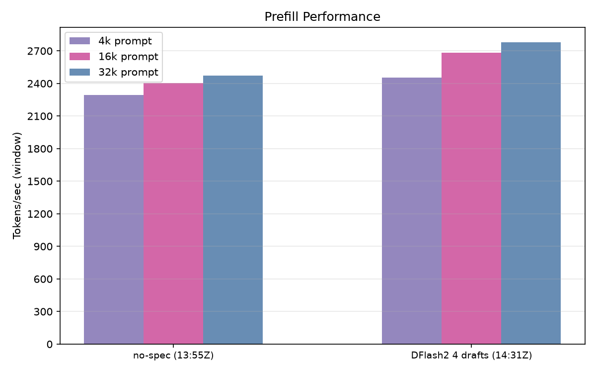
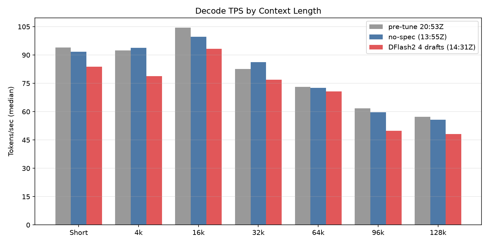
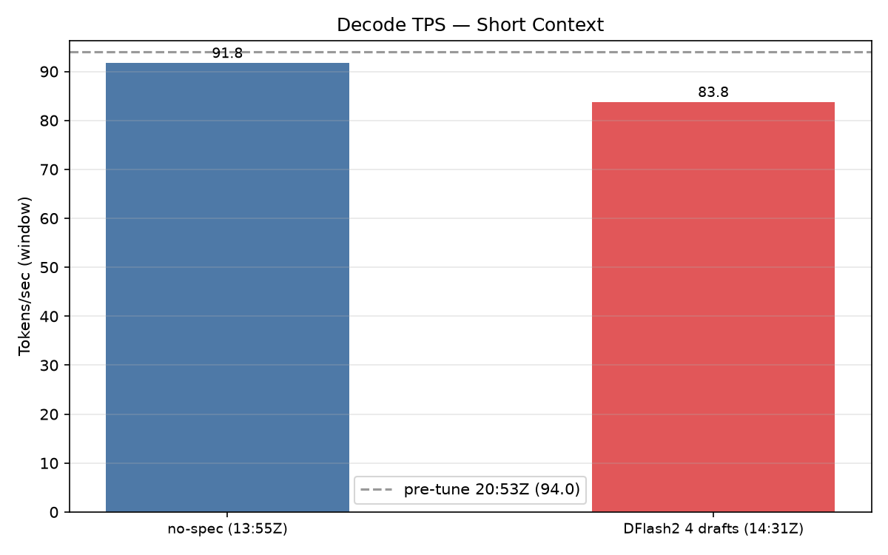
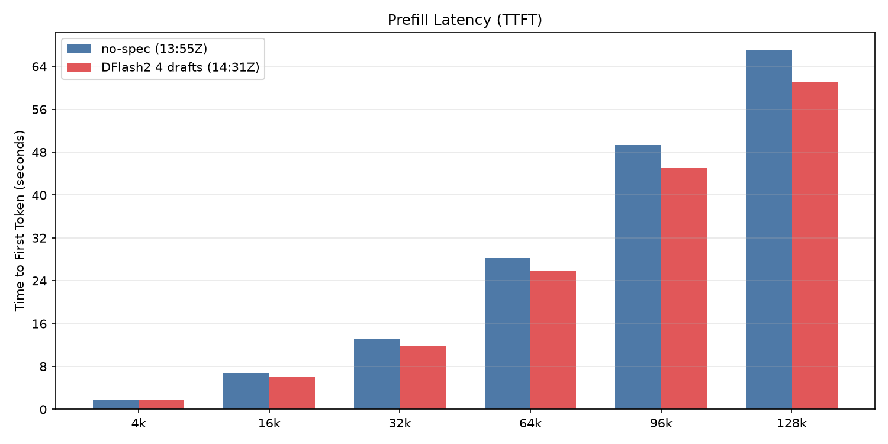

# Ornith 1.5 35B-A3B — Tweak Benchmarks (2026-11-15)

Same setup as [Qwen3.6-35b-a3b-improvements.md](Qwen3.6-35b-a3b-improvements.md):
Radeon 9070 XT (16 GB), Ryzen 7 5700X3D (8 cores, unlocked 105 W PPT, PBO 0),
32 GB, Linux DL1 (console), with the exllamav3 recipe fork from
[`willeyh-git/exl3-rdna4-recipe`](https://github.com/willeyh-git/exl3-rdna4-recipe)
built on 2026-11-14 (`d09c8b86`, includes the chunk-size, output_chunking,
cpu_stage_threads and vision-offload work ported from QFN's recipe). Two full
(llm-bench) runs were taken on the tuned baseline with the two draft variants,
compared against the pre-tune exllamav3 20:53Z run.

## Default baseline

The Ornith exllamav3 20:53Z run (pre-tune, DFlash2 4-draft config) is the
pre-tune reference used throughout this doc; it was also the original README
winner combination (EXL3 4.0 bpw + DFlash2, exllamav3): 1 168 tok/s prefill,
57.3 tok/s decode at 128k (see [ORNITH1.5-35B-A3B.md](ORNITH1.5-35B-A3B.md)).

## Tweaked configs

Two configs were used; both carry the Qwen3.6 tweak (chunk 5120 +
output_chunking, vision offload, pinned arena off, `cpu_moe_threads: 7`,
`EXL3_MOE_CPU_STAGE_THREADS=6`, same MoE swizzle/wide as the Qwen tweak
baseline → default on, `EXL3_MOE_CPU_WIDE` not set). The CPU expert split is
kept from the **original Ornith config** (`cpu_moe_split_experts: 108`,
`autosplit_reserve: 768`), not copied from Qwen (100/512).

| File | Used for | Draft model block |
| --- | --- | --- |
| `config.ornith.yml` (original) | — (reference) | — |
| `config.ornith-tweak.yml` | Run 2 (14:31Z) | `draft_model_name: Ornith-1.5-35B-A3B-DFlash2-EXL3-3.0bpw`, `draft_num_tokens: 4` (`draft_type: model`) |
| (in-memory variant of the same file) | Run 1 (13:55Z) | **no draft option set at all** — the DFlash2 drafter file was present in the model dir but not named |

> ⚠️ Run 1's spec state is **unverified**: tabbyApi's default when no draft
> option is set (whether it ever picks up the drafter file on disk) is not
> recorded in the run tag or the JSON. The "no spec" label follows the tag;
> verify against the server logs before treating Run 1 as a definitive
> no-spec reading.
>
> The `config.ornith-tweak.yml` file as saved on disk is a later state
> (`chunk_size: 8192`, `autosplit_reserve: 512`, `cpu_moe_split_experts`
> removed); both runs' tags record **5120**, so the values below reflect the
> 13:55Z/14:31Z run-time config.

Key run-time settings (both runs):

| Setting | Value |
| --- | --- |
| Model | `Ornith-1.5-35B-A3B-EXL3-4.00bpw-24GB` |
| Cache | Q8, 130 816 tokens |
| GPU split | auto, reserve 768 MB |
| CPU offloaded experts | 108 (`cpu_moe_split_experts`) |
| CPU MOE threads | 7 |
| `EXL3_MOE_CPU_STAGE_THREADS` | 6 |
| Pinned arena | off |
| chunk_size / output_chunking | 5120 / on |
| Vision offload | on |
| VRAM at start | 14.9 GB |
| Draft (Run 1) | unset (see caveat) |
| Draft (Run 2) | DFlash2 EXL3 3.0 bpw, 4 draft tokens |

## Runs (chronological)

| # | Timestamp | Tag | Draft | VRAM | Short decode (med) | 4k | 16k | 32k | 64k | 96k | 128k |
|---|-----------|-----|---------|------|--------------------|----|----|-----|-----|-----|------|
| 1 | 2026-11-15 13:55Z | `pinned experts false and batch increase 5120 vision offload vision off 14.9gb vram cpu_stage_threads 6, threads 7, FULL RUN` | unset (unverified) | 14.9 GB | **91.8** | 93.8 | 99.6 | 86.3* | 72.7 | 59.7 (n=2) | 55.7 (n=2) |
| 2 | 2026-11-15 14:31Z | `… threads 7, FULL RUN dflash2 num tokens 4` | DFlash2, 4tok | 14.9 GB | 83.8 | 78.8* | 93.2 | 76.9 | 70.7 | 49.8 (n=2) | 48.2 (n=2) |

* 13:55Z @32k median includes 3 early-stop runs (197/205/221 of 512);
  14:31Z @4k median includes 1 early-stop (33 of 512). 96k/128k medians rest
  on only 2 runs (flagged in the JSON).

## Prefill

| # | 4k TPS (TTFT) | 16k TPS | 32k TPS | 64k TPS | 96k TPS (n=2) | 128k TPS (n=2) |
|---|---------------|---------|---------|---------|---------------|----------------|
| 1 | **2 294** (1.81 s) | 2 406 | 2 473 | 2 311 | 1 998 | 1 925 (67.0 s) |
| 2 | 2 455 (1.69 s) | **2 682** | **2 780** | **2 528** | **2 189** | **2 111** (61.1 s) |

Pre-tune exllamav3 20:53Z for reference: 1 293 / 1 356 / 1 344 / 1 279 /
1 222 / 1 168. The tweak baseline roughly **doubles prefill at 128k**
(n=2 per run, caveat applies).

## Decode

| # | Context | Min | Median | Max | n |
|---|---------|-----|--------|-----|---|
| 1 | ~16 short | 89.30 | **91.77** | 97.87 | 5 |
| 1 | 4k | 87.90 | 93.83 | 99.07 | 5 |
| 1 | 16k | 95.47 | 99.62 | 103.10 | 5 |
| 1 | 32k | 76.46 | 86.29* | 104.53 | 5 |
| 1 | 64k | 68.46 | 72.66 | 74.74 | 5 |
| 1 | 96k | 59.15 | 59.65 | 60.16 | 2 |
| 1 | 128k | 53.65 | 55.66 | 57.67 | 2 |
| 2 | ~16 short | 79.16 | 83.80 | 86.11 | 5 |
| 2 | 4k | 58.28 | 78.83* | 86.03 | 5 |
| 2 | 16k | 92.54 | 93.22 | 96.62 | 5 |
| 2 | 32k | 75.16 | 76.92 | 86.62 | 5 |
| 2 | 64k | 63.65 | 70.69 | 72.34 | 5 |
| 2 | 96k | 37.42 | 49.82 | 62.22 | 2 |
| 2 | 128k | 46.12 | 48.16 | 50.20 | 2 |

Pre-tune exllamav3 20:53Z: 94.0 / 92.3 / 104.5 / 82.6 / 73.1 / 61.7 / 57.3.

## Graphs

`uv run --with matplotlib python plots/generate_ornith_tweaks.py`

## Findings

1. **Prefill more than doubles at the long end vs pre-tune.** 128k is 1 925
   (Run 1) / 2 111 (Run 2) vs 1 168 tok/s in the 20:53Z run, and the gap is
   similar at 64k (2 311 / 2 528 vs 1 279). The short end also jumps
   (2 294–2 455 vs 1 293 at 4k). These are the same chunk / output_chunking /
   stage-thread / vision-offload changes that gave Qwen3.6 its 4k/64k prefill
   gains.
2. **Decode is roughly flat with the tweak baseline (Run 1).** Short context
   91.8 vs 94.0 (−2%), 4k +2%, 16k −5%, 32k +4% (contaminated by early-stops),
   64k flat, 96k −3%, 128k −3%. No meaningful decode regen, as on Qwen3.6.
3. **DFlash2-4 (Run 2) costs decode across the whole range** (−11% short,
   −15% at 4k–64k, −19% at 96k, −16% at 128k) while *prefill is still faster*
   at length than Run 1 (2 189 / 2 111 vs 1 998 / 1 925). A speculative run
   is not supposed to out-prefill the one without a drafter — combined with
   the annotation caveat (Run 1's spec state was never actually recorded),
   treat the draft-vs-no-draft split in these two runs as **unconfirmed**.
   Re-run with `--log-draft-acceptance`/server logs to separate the effects.
4. **Winner for the README changed** — Run 1 (tweak baseline) now heads the
   Ornith 128k combo: 1 925 + 55.7 = **2 480** vs the previous DFlash2 winner
   1 168 + 57.3 = **1 725**. The DFlash2-4 run also beats the old winner
   (2 111 + 48.2 = 2 159) but loses to Run 1. The 96k/128k medians rest on 2
   runs each, so this should be re-confirmed with a full 5-run 96k/128k pass
   before it is treated as settled.

## Next steps

- Re-run 96k/128k decode with 5 runs each on the spec-off variant to firm up
  the winner numbers (n=2 today).
- Add `--log-draft-acceptance` to the DFlash2 run to see whether the drafts
  are being accepted or whether Run 2 is actually decoding with the drafter
  in the first place (required to fix the annotation).
- If you want to run spec-off, once the annotation is confirmed, consider
  32k–64k decode as the primary utilization metric (where Run 1 leads the
  DFlash2-4 run by ~6–10 tok/s).

## Raw results

| # | File | Tags |
|---|------|-------------|
| 1 | [results/ornith/exllamav3-20261115T135554Z-ornith-1-5-35b-a3b-exl3-4-00bpw-24gb-tuned.json](results/ornith/exllamav3-20261115T135554Z-ornith-1-5-35b-a3b-exl3-4-00bpw-24gb-tuned.json) | tuned baseline 5120 batch + vision offload + 14.9 GB VRAM, stage 6 / thread 7, FULL RUN (draft unset) |
| 2 | [results/ornith/exllamav3-20261115T143144Z-ornith-1-5-35b-a3b-exl3-4-00bpw-24gb-tuned-dflash2.json](results/ornith/exllamav3-20261115T143144Z-ornith-1-5-35b-a3b-exl3-4-00bpw-24gb-tuned-dflash2.json) | same + DFlash2 drafter 4 draft tokens (draft_type: model) |